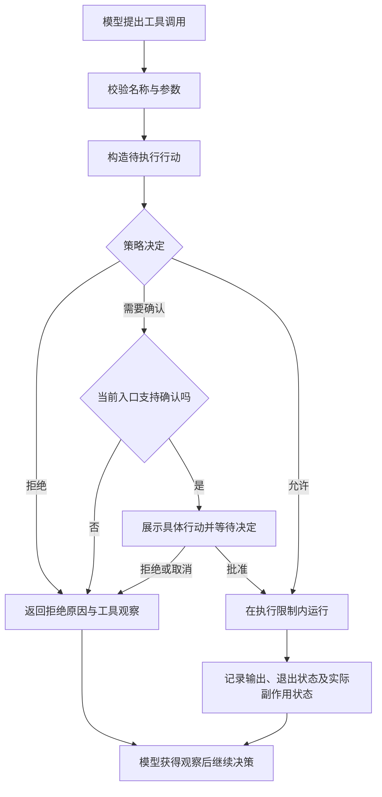

# OpenCode 与 Codex：模型工具、权限控制与危险命令审批

核查日期：2026-10-15。本文回答两个问题：编程 Agent 把哪些能力交给模型调用，以及模型提出行动后，谁决定执行、审批或拒绝。

范围：OpenCode 以官网当前 V2 文档为主，另列 V1 名称差异；Codex 以当前官方 CLI、桌面端共用能力文档为主。不同版本、模型、插件、账号和运行环境会改变实际工具集。本文是文档与实现机制调研，不是对两个产品进行攻击测试后的安全认证。

证据分为三类：**官方文档事实**、**本次 Codex 会话可见工具定义**、**本文的工程分析**。工具示例只展示接口思路；除明确说明外，没有在本机安装 OpenCode、修改权限设置或执行危险命令。

## 1. 先抓住四个区别

1. **模型调用工具，宿主程序执行工具。** 模型通常获得工具名称、描述和参数 schema，输出调用请求；Agent 宿主负责校验、权限判断、执行和返回结果。工具 handler、操作系统权限和第三方凭据不由模型输出的一句“已批准”决定。
2. **工具数量与实际能力不成正比。** 一个通用 shell 就能读写文件、运行 Python、使用 Git、调用网络程序。增加 `read`、`patch` 等专用工具，主要是在改善接口、观察结果与权限粒度。
3. **审批与沙箱处理不同问题。** 审批决定“这次是否允许做”；沙箱限制“即使执行了，最多能接触什么”。模型提示词中的禁止条款属于行为约束，不能代替执行层限制。
4. **危险操作未必触发审批。** 操作可能落在已允许的工具规则或可写目录内。尤其不能把“允许改项目文件”理解成“项目文件不可能被误删”。

以上是对两者设计的归纳。Codex 明确把 sandbox 与 approval policy 分开；OpenCode 的工具权限也不等同于 OS 隔离。具体事实和限制见后文。[Codex 沙箱](https://learn.chatgpt.com/docs/sandboxing)、[OpenCode V2 权限](https://opencode.ai/v2/docs/permissions)

## 2. 模型眼中的“工具”是什么

可以把工具接口理解成下面的约定。以下是**本文自拟的简化示例**，不是任一产品的完整 schema：

```json
{
  "name": "shell",
  "description": "在绑定的工作目录执行命令并返回输出",
  "parameters": {
    "type": "object",
    "properties": {"command": {"type": "string"}},
    "required": ["command"]
  }
}
```

模型可能请求 `shell({"command": "git status --short"})`。真正执行前，宿主仍可判定参数非法、需要审批或禁止执行；执行后再把 stdout、stderr、退出码等观察返回模型。OpenAI 官方工具指南也区分工具定义、模型调用与应用执行。[Function calling](https://developers.openai.com/api/docs/guides/function-calling)

实际可以分成三层：

| 层次 | 例子 | 为什么要区分 |
|---|---|---|
| 模型直接调用的入口 | 命名工具，或执行一段受控 JavaScript 的 Code Mode 入口 | 决定模型如何表达行动 |
| 入口下面的具体能力 | shell、文件补丁、网页抓取、MCP 工具、子 Agent | 决定实际副作用以及应检查的权限 |
| 工具调用的底层程序/服务 | `rg`、`git`、`pytest`、数据库、邮件服务 | 通常不是独立注入模型的工具；仍有自己的权限和失败行为 |

因此，“Codex 会用 Git”不意味着它必然提供名为 `git` 的内置工具；通过 shell 执行 Git 同样能完成任务。类似地，Code Mode 包装了多个调用，也不意味着嵌套调用可以绕过审批。当前 Codex 的 hook 文档明确说明，JavaScript 中的嵌套工具调用仍经过相应 hook。[Codex Hooks](https://learn.chatgpt.com/docs/hooks)

## 3. OpenCode：工具与权限

<!-- OPENCODE_RESEARCH_SECTION -->

## 4. Codex：工具与权限

### 4.1 工具清单应分“核心能力”和“条件扩展”

官方没有承诺一个所有客户端、所有模型都完全相同的永久工具清单。下面列出能由官方文档核实的主要能力；涉及本次会话工具名的地方单独标注。

| 能力 | 代表工具或入口 | 做什么及适用范围 |
|---|---|---|
| 命令执行 | `shell_command`，或 `exec_command` | 运行系统命令；读取代码、搜索、Git、构建、测试通常都能经此完成 |
| 持续运行进程交互 | `write_stdin` | 向已有执行会话输入内容、读取后续输出；与 `exec_command` 配合 |
| 文件编辑 | `apply_patch` | 用明确的补丁新增、修改或删除文件 |
| 计划状态 | `update_plan` | 更新步骤及状态；官方工具指南和 hook 文档列举此名称，不表示每个会话都必定启用 |
| 本地图片查看 | `view_image` | 将磁盘中的图片提供给模型；本次会话可见，官方示例配置也有图片工具开关 |
| 网页检索 | Web search | 搜索和访问网页；可配置检索模式，和本地 shell 的联网权限分开 |
| 子 Agent | 创建、传递指令、等待、停止等协作工具 | 委派独立任务并收集结果；受是否启用、并发及权限设置约束 |
| MCP | 由服务器提供的命名工具、资源接口 | 接入文档、代码托管、数据库等外部能力；工具随连接变化 |
| 桌面/插件扩展 | 浏览器、文档、图片生成、聊天与工作树管理等 | 属于宿主或插件能力，不能当成所有 Codex CLI 安装的默认工具 |

命令、补丁、计划工具依据 [Codex Prompting Guide](https://developers.openai.com/cookbook/examples/gpt-5/codex_prompting_guide)；图片开关依据 [示例配置](https://learn.chatgpt.com/docs/config-file/config-sample)；其余分别见 [Web search](https://learn.chatgpt.com/docs/agent-approvals-security#traffic-outside-the-command-network-proxy)、[Subagents](https://learn.chatgpt.com/docs/agent-configuration/subagents)、[MCP](https://learn.chatgpt.com/docs/extend/mcp)、[Plugins](https://developers.openai.com/plugins/plan/tools)。Prompting Guide 是接口设计材料，不是当前版本全部注册工具的快照。

**本次会话的具体观察：**命令工具为 `exec_command` / `write_stdin`，编辑工具为 `apply_patch`；还有 `view_image`、用户输入工具、子 Agent 工具，以及浏览器和插件工具。`functions.exec` 是受控 JavaScript 编排入口，通过 `tools.*` 调用下层工具；它本身不直接提供 Node 文件系统或网络访问。这是本次运行的可见接口事实，不外推为所有 Codex 发行版的固定清单。

### 4.2 权限至少包含三个独立维度

| 维度 | 主要设置 | 解决的问题 |
|---|---|---|
| 执行边界 | `sandbox_mode` 或 permissions profile | 文件哪些路径可读/可写，命令能否联网 |
| 审批触发 | `approval_policy`、执行规则、各工具审批设置 | 哪些行动需要停下来等待许可，哪些直接拒绝 |
| 审批者 | `approvals_reviewer` | 由用户决定，还是交给独立 reviewer agent |

这三个维度可以组合，不能只用一个“自动模式”概括。[官方权限模型](https://learn.chatgpt.com/docs/sandboxing)、[配置参考](https://learn.chatgpt.com/docs/config-file/config-reference)

常见组合：

| 配置 | 行为 |
|---|---|
| `read-only` + `on-request` | 在只读边界内读取和执行允许的命令；需要更多访问能力时请求审批 |
| `workspace-write` + `on-request` | 可以在允许范围内修改项目并运行命令；越界操作进入审批流程 |
| `workspace-write` + `never` | 保留沙箱，但不弹审批请求；不能据此获得越界执行权限 |
| `danger-full-access` + `never` | 同时失去本地沙箱限制与交互审批 |
| `workspace-write` + `on-request` + `auto_review` | 保留原有沙箱，把符合条件的审批请求交给自动审查 |

表中的 `read-only` 不表示所有命令都不能运行，关键是命令是否符合只读沙箱。官方安全页的组合表明确允许只读沙箱内命令。[审批组合](https://learn.chatgpt.com/docs/agent-approvals-security#common-sandbox-and-approval-combinations)

当前文档有一个版本陷阱：`approval_policy = "untrusted"` 已不受支持，`on-failure` 已弃用；`projects.<path>.trust_level = "untrusted"` 则是另一个项目信任设置，不能混为同一字段。本文不沿用旧文章常见的“四种审批模式”表。[配置参考](https://learn.chatgpt.com/docs/config-file/config-reference)、[迁移说明](https://learn.chatgpt.com/docs/agent-approvals-security#migrate-from-the-retired-untrusted-approval-policy)

### 4.3 沙箱限制的是实际执行，不只是工具名称

命令及其子进程受到执行环境限制。即使模型通过 shell 启动 Python，文件系统和网络边界也不会因为换了语言就自动消失。具体实现因平台而异：macOS 使用 Seatbelt；当前 Linux/WSL 文档说明使用 bubblewrap 及相应后备机制。[沙箱实现](https://learn.chatgpt.com/docs/sandboxing)

Windows 当前文档列出 MXC、`elevated`、`unelevated` 三条路径。MXC 使用原生进程隔离；`elevated` 的名称指需要管理员批准的初始化，沙箱中的命令仍以非管理员权限运行；`unelevated` 是隔离能力较弱的后备路径。因此不能把 Windows 下所有 Codex 执行都描述为同一种容器或同一种网络防护。[Windows sandbox](https://learn.chatgpt.com/docs/windows/windows-sandbox)

默认 `workspace-write` 也不是“整个项目任意可写”：当前文档把可写根目录下的 `.git`、`.agents`、`.codex`、`.aws` 列为受保护路径。反过来，限制写入范围不等于只允许读取这个目录，读取范围要看实际权限配置。[受保护路径](https://learn.chatgpt.com/docs/agent-approvals-security#protected-paths-in-writable-roots)

### 4.4 命令规则：按参数前缀判断，不是简单字符串开头匹配

Codex 的 `.rules` 文件使用 `prefix_rule`，按命令参数序列匹配，决策为 `allow`、`prompt`、`forbidden`。多个规则同时匹配时采用最严格结果：`forbidden > prompt > allow`。官方主要把它定位为控制沙箱外命令放行的机制。[Rules](https://learn.chatgpt.com/docs/agent-configuration/rules)

下面是**本文编写的规则示例**，未安装到本机：

```python
prefix_rule(
    pattern=["git", "push"],
    decision="prompt",
    justification="推送会更新远端仓库，需要审批",
)

prefix_rule(
    pattern=["git", "reset", "--hard"],
    decision="forbidden",
    justification="避免丢弃未提交工作",
)
```

这是对两个命令前缀的政策示例，**不是禁止一切远端写入或一切本地破坏的完整方案**。不同参数顺序、其他程序或脚本仍需相应政策和执行边界。

对可安全解析的简单 shell 命令链，Codex 会拆成多个命令分别检查，再取最严格结果。含变量展开、重定向、替换或复杂控制流时，规则可能针对整个 shell 调用，而不是猜测脚本语义。不能通过批准一个宽泛的 shell/Python 前缀来表达“只允许安全脚本”。[复合命令处理](https://learn.chatgpt.com/docs/agent-configuration/rules#shell-wrappers-and-compound-commands)

一次批准、会话范围批准和持久规则是不同授权范围；在 TUI 中保存命令允许规则会写入用户规则文件。规则可用 `codex execpolicy check` 离线匹配检查，避免为了验证规则真的执行危险命令。[审批范围](https://learn.chatgpt.com/docs/sandboxing#how-permissions-work)、[规则保存与检查](https://learn.chatgpt.com/docs/agent-configuration/rules)

### 4.5 自动审批：独立审查者决定，不由主模型自行授权

`approvals_reviewer = "auto_review"` 把符合条件的审批请求交给另一个 reviewer agent。它看到待执行行动和相关会话证据，返回决定与理由；明确拒绝后，主 Agent 应找实质上更安全的方案，或交还用户处理。[Auto-review](https://learn.chatgpt.com/docs/sandboxing/auto-review)

需要理解其覆盖范围：

- 它处理已经需要审批的请求，例如提权执行、越界编辑和需要许可的外部工具调用。
- 沙箱内本来就允许的操作不增加一次自动审查。
- 开启自动审查不会自动扩大目录或网络权限。
- reviewer 本身也可能判断错误，因此仍需沙箱和组织策略。

这些是官方明确说明的限制。[Auto-review 的触发与限制](https://learn.chatgpt.com/docs/sandboxing/auto-review)

一个常见的配置形状如下，**仅展示配置，不修改本机设置**：

```toml
sandbox_mode = "workspace-write"
approval_policy = "on-request"
approvals_reviewer = "user"  # 符合条件时也可选 auto_review

[sandbox_workspace_write]
network_access = false
```

实际仍受管理员配置和运行环境约束。`never` 表示不请求审批，不能理解为“所有审批自动同意”。[配置参考](https://learn.chatgpt.com/docs/config-file/config-reference)

### 4.6 MCP、联网与 hooks 各有自己的边界

**MCP 工具。** 可用 `enabled_tools` / `disabled_tools` 控制暴露范围，再配置服务器或单工具审批模式；`writes` 模式针对未标记为只读的工具请求审批。这只是一层宿主控制，第三方服务仍须验证用户身份和资源权限。[MCP 配置](https://learn.chatgpt.com/docs/extend/mcp)

工具的 `readOnlyHint`、`destructiveHint` 等声明帮助宿主决定如何呈现和审批，不能替代服务端授权。如果一个远程服务错误地放行了操作，本地 shell 沙箱不能替它补上数据库或邮件权限。[工具注解](https://developers.openai.com/plugins/reference#annotations)

**联网。** shell 子进程网络、网页搜索、MCP、浏览器和连接器不是同一个出口。本地命令不能联网，不表示所有这些工具都不能联网；各入口要分别控制。[网络控制范围](https://learn.chatgpt.com/docs/agent-approvals-security#traffic-outside-the-command-network-proxy)

**Hooks。** `PreToolUse` 可以检查并拒绝受支持的本地工具调用，`PermissionRequest` 介入已经触发的审批请求。当前文档也明确列出覆盖例外、错误可能不阻止工具、`PreToolUse` 的 `ask` 尚不受支持等限制。不能写一个未经验证的 hook 就宣称所有危险行动都会审批；执行后的 hook 更不能撤销已发生的副作用。[Hooks 覆盖范围和返回语义](https://learn.chatgpt.com/docs/hooks)

## 5. 危险命令究竟什么时候审批

下表是**根据上述机制推导的场景分析**，不是本次实测结果。假设操作未被其他管理员规则、插件或模型行为策略额外拦截。

| 场景 | OpenCode V2 | Codex |
|---|---|---|
| 查看 `git status` | `shell` 规则允许即可运行，也能设为询问 | 在允许的沙箱范围内通常可运行 |
| 删除项目内普通文件 | 取决于 `shell`/编辑行动规则，默认允许不代表自动识别危险 | 可写范围内的删除未必触发审批；沙箱不保护所有项目内容免遭破坏 |
| 修改项目外文件 | 可能触发 `external_directory`；shell 的识别有覆盖限制 | 超出可写范围时由执行限制阻止，必要时进入许可流程 |
| 安装依赖或访问网络 | shell 本身具有宿主网络能力；匹配规则可要求审批 | 看命令网络权限和策略；网络受限时可能需要审批 |
| `git push` | 可以将匹配的 shell 命令设为 `ask`/`deny` | 可配置 `prompt`/`forbidden` 前缀规则；已有允许规则也可能免提示 |
| 通过远端 MCP 删除数据 | 需要工具规则和远端服务授权共同控制 | 需要工具可用性、审批设置与远端服务授权共同控制 |
| 运行一个 Python 脚本 | shell 放行不等于逐条审查脚本内部行为 | 脚本仍受沙箱限制，但命令批准不等于证明脚本安全 |

依据：[OpenCode 权限](https://opencode.ai/v2/docs/permissions)、[Codex 沙箱](https://learn.chatgpt.com/docs/sandboxing)、[Codex Rules](https://learn.chatgpt.com/docs/agent-configuration/rules)、[Codex MCP](https://learn.chatgpt.com/docs/extend/mcp)。

用户看到的“危险命令需审批”，一般是下面几个条件共同作用的结果：工具规则要求确认、操作超出执行边界、工具声明了副作用、管理员设置了策略，或 Agent 按行为指令主动请求许可。它并不必然来自一个能完整理解所有程序语义的“危险命令识别器”。

## 6. 对 code_agent 的参考价值

这部分是工程建议。当前默认 Bash，M3 负责执行环境校验，命令策略和操作确认属于 M4c；基础审批已经接线，规则与授权范围仍需完善。具体顺序遵循 [PLAN.md](../../PLAN.md)，OS 沙箱保持可选扩展，产品工具数量不作为学习目标。

### 6.1 一个 Bash 工具也需要独立权限入口

即使只暴露 Bash，也可以把“参数校验”“策略决定”“用户确认”“真正执行”分开。示意流程如下；这是适用于本项目的设计图，不声称与任一产品内部调用顺序完全一致。



建议先能回答四件事：**谁提出行动、谁批准、批准了什么范围、最终是否执行**。不要把模型生成的 `approved: true` 当作授权，也不要把“拒绝执行”写成“执行成功但没有输出”。

### 6.2 审批必须针对具体行动

一个可审查的行动至少需要：工具名、完整命令或文件变更、规范化工作目录/目标路径、权限扩大范围、请求原因、决定及有效范围。这里列的是设计要素，不要求为每项新增一个类。

批准“在某目录运行这条命令”不应默默变成“以后所有 Python 都可运行”。参数或执行目标变化后，应重新检查是否仍被原授权覆盖；恢复会话时也要区分一次性批准与持续规则。这个设计能避免在 UI 上问得很细，执行层却放得过宽。

### 6.3 明确声明能保护什么

- 固定 `cwd` 只是初始工作目录，无法阻止绝对路径、`..` 或子进程访问外部资源。
- 针对若干危险命令的拒绝规则，可以验证“这些样例会被拦住”，不能据此宣称通用 shell 已安全隔离。
- 专用文件工具便于检查路径与呈现 diff，但只要同时允许任意 shell，就还存在另一条文件访问路径。
- 取消、超时、输出预算有助于控制资源；它们不能撤回已经发生的删除或远端写入。
- 把不确定行动交给 LLM reviewer 能补充语义判断，但不能替代确定性权限和执行边界。

这些边界与项目现有安全定位一致。[PLAN.md：已确定的技术决策与 M3/M4](../../PLAN.md)

## 7. 阅读入口与核查限制

建议先读 OpenCode 的 Tools / Permissions，再读 Codex 的 Sandbox / Rules / Auto-review。读源码时应从“注册工具 → 准备行动 → 权限决定 → 实际执行”沿调用链追踪，不只搜索 `rm` 等危险关键词。

| 主题 | 一手资料 |
|---|---|
| OpenCode 当前工具与权限 | [V2 Tools](https://opencode.ai/v2/docs/tools)、[V2 Permissions](https://opencode.ai/v2/docs/permissions) |
| Codex 核心工具接口示例 | [Codex Prompting Guide](https://developers.openai.com/cookbook/examples/gpt-5/codex_prompting_guide) |
| Codex 执行边界与平台实现 | [Sandbox](https://learn.chatgpt.com/docs/sandboxing)、[Windows sandbox](https://learn.chatgpt.com/docs/windows/windows-sandbox) |
| Codex 命令判断与自动审查 | [Rules](https://learn.chatgpt.com/docs/agent-configuration/rules)、[Auto-review](https://learn.chatgpt.com/docs/sandboxing/auto-review) |
| Codex 外部工具与自定义检查 | [MCP](https://learn.chatgpt.com/docs/extend/mcp)、[Hooks](https://learn.chatgpt.com/docs/hooks) |
| Codex 配置与兼容性 | [Configuration reference](https://learn.chatgpt.com/docs/config-file/config-reference)、[Agent approvals & security](https://learn.chatgpt.com/docs/agent-approvals-security) |

核查限制：官方页面会更新，本次没有固定 Codex 的源码提交，也未审阅桌面端全部内部工具注册逻辑；不能把本次会话的工具清单或官方示例配置当作所有安装的默认值。涉及 shell 解析、符号链接、子进程、网络隔离的具体保证，仍需要针对选定版本和操作系统验证。本文未把搜索摘要、论坛讨论或旧笔记当作已验证的当前实现事实。
