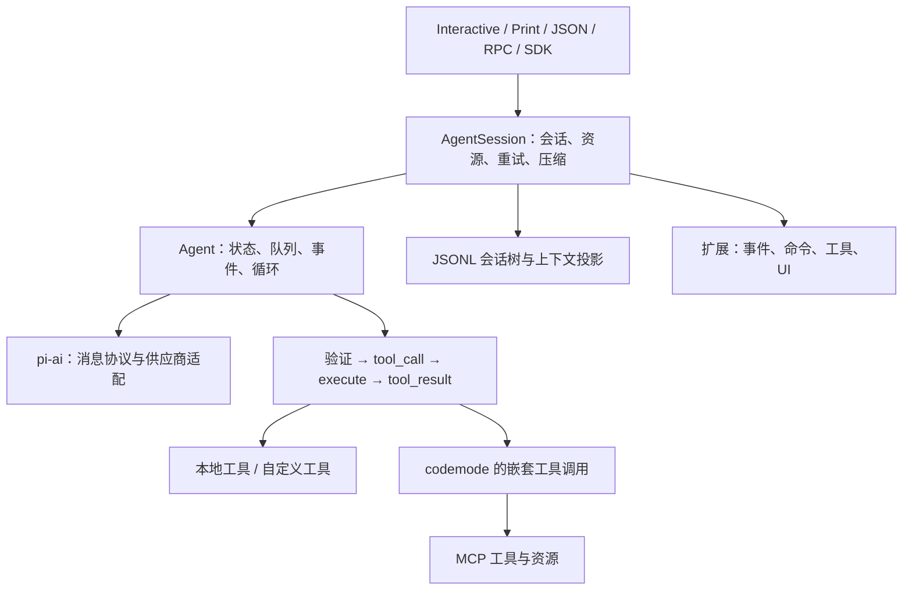
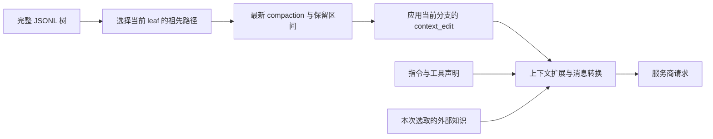

# Pi Coding Agent 设计研究：循环、记忆、上下文、工具、运行模式、协同与评测

> 研究日期：2026-10-22（Asia/Shanghai）。本文是设计参考，不改变 `PLAN.md`、当前里程碑或核心由用户手写的协作约定。
>
> 上游：原 `badlogic/pi-mono` 已重定向至 [`earendil-works/pi`](https://github.com/earendil-works/pi)。源码固定于 [`be14d9732f98fcc33929cf103a92b96afaa6523e`](https://github.com/earendil-works/pi/commit/be14d9732f98fcc33929cf103a92b96afaa6523e)，提交时间为 `2026-10-22T12:25:58Z`；该快照中 `@earendil-works/pi-coding-agent` 的包版本是 `1.4.0`，不据此声称这个 commit 就是某个正式发布 tag。
>
> 阅读方法：**上游事实**以这个快照的文档、实现和测试为依据；**历史观点**单独标明日期；**本项目建议**是研究后的推导。所有伪代码均为自写的等价逻辑简化，用于解释契约，不是可直接运行的 Pi 或本项目实现。未安装、运行 Pi，也未执行真实模型或 Docker 评测。

2026-10-28 修订项目状态、预算示意和接口迁移建议；上游仍以原固定提交为研究对象，本次只抽查循环源码，未将全篇结论重新验证为最新 Pi 行为。

## 阅读导航

遇到具体故障可先读“本项目问题对照”；理解实现时按循环、上下文、工具、模式与评测的顺序阅读。

- [先掌握几个结论](#先掌握几个结论)
- [分层：谁负责模型、调度、会话与界面](#分层谁负责模型调度会话与界面)
- [Agent 循环：一轮是什么、为何继续、何时停止](#agent-循环一轮是什么为何继续何时停止)
- [上下文：完整记录、有效分支与本次请求分别管理](#上下文完整记录有效分支与本次请求分别管理)
- [记忆与知识：Pi 提供接点，项目需要定义生命周期](#记忆与知识pi-提供接点项目需要定义生命周期)
- [新探索：Pi Durable 是另一条运行时路线](#新探索pi-durable-是另一条运行时路线)
- [工具：从模型参数到真实副作用](#工具从模型参数到真实副作用)
- [权限、项目信任与执行隔离](#权限项目信任与执行隔离)
- [运行模式：四个界面，共用一个 Agent](#运行模式四个界面共用一个-agent)
- [扩展事件：哪里观察、哪里改写、哪里决定继续](#扩展事件哪里观察哪里改写哪里决定继续)
- [MCP 与 codemode：工具很多时如何控制上下文和执行](#mcp-与-codemode工具很多时如何控制上下文和执行)
- [多 Agent：官方示例做了什么、没有做什么](#多-agent官方示例做了什么没有做什么)
- [测试与 Agent 评测：分别回答“实现对不对”和“任务做得怎样”](#测试与-agent-评测分别回答实现对不对和任务做得怎样)
- [遇到问题时怎么查：本项目问题与 Pi 机制对照](#遇到问题时怎么查本项目问题与-pi-机制对照)
- [可以继续探索的实验：先定义问题，再比较方案](#可以继续探索的实验先定义问题再比较方案)
- [源码阅读路线与回查方法](#源码阅读路线与回查方法)
- [一手来源与代码导航](#一手来源与代码导航)

## 先掌握几个结论

Pi 最值得参考的是几条可检查的边界：模型协议适配、通用 Agent 调度、会话生命周期、工具执行、副作用和 UI 分开；会话历史、下一次请求的上下文、界面展示也分开。核心循环本身并不需要知道终端怎样渲染，工具也不必知道模型供应商。它仍然需要处理许多不能省略的细节：中断、半截参数、并行结果排序、重试、压缩以及真正完成的时刻。[分层与运行过程](https://github.com/earendil-works/pi/blob/be14d9732f98fcc33929cf103a92b96afaa6523e/packages/coding-agent/docs/how-pi-works.md)

不要把 2025 年的 Pi 宣言当成 2026 年 API 文档。当前快照已有原生 MCP 集成、codemode、tool search、自动压缩、带动作的回合边界以及独立 `durable` 包。核心仍未内建固定的 subagent 工作流和 plan mode，但仓库提供两者的扩展示例。默认四工具 `read`、`bash`、`edit`、`write` 是产品默认值，不代表工具框架只允许四个工具。[当前 README](https://github.com/earendil-works/pi/blob/be14d9732f98fcc33929cf103a92b96afaa6523e/README.md)、[工具与 MCP 选项](https://github.com/earendil-works/pi/blob/be14d9732f98fcc33929cf103a92b96afaa6523e/packages/coding-agent/docs/cli.md#tools)

读到“没有更多 tool call”时，只能判定一条自然续跑路径消失；它不证明任务正确完成。Pi 还有 steering、follow-up、`finishTurn`、错误恢复和 `agent_before_settle`。对外自动化应等待会话级 `agent_settled`，再用验收标准判断成功。[循环](https://github.com/earendil-works/pi/blob/be14d9732f98fcc33929cf103a92b96afaa6523e/packages/agent/src/agent-loop.ts#L169-L326)、[JSON 生命周期](https://github.com/earendil-works/pi/blob/be14d9732f98fcc33929cf103a92b96afaa6523e/packages/coding-agent/docs/json.md#event-sequence)

## 分层：谁负责模型、调度、会话与界面

| 层 | 实际职责 | 不应混入的职责 |
|---|---|---|
| `packages/ai` | 统一消息、流式事件、模型元数据、供应商适配、参数验证 | 工作流、项目文件策略、终端交互 |
| `packages/agent` | Agent 状态与循环、工具调度、事件、steering/follow-up | JSONL 会话树、终端组件、固定规划工作流 |
| `packages/coding-agent/src/core` | 配置与资源、会话、压缩、重试、扩展连接 | 具体终端渲染布局 |
| `packages/coding-agent/src/modes` | 交互、print、RPC 的输入输出适配 | 另写一套工具调用循环 |
| `packages/tui` | 终端输入、布局、差分渲染等组件 | 模型和工具的业务状态 |
| `packages/mcp`、`packages/codemode` | MCP 连接协议、受限 JavaScript 执行基础设施 | 决定整个产品的权限边界 |
| `packages/evals` | 真实 Agent 行为评测、隔离、配对报告 | 以单测代替模型任务成功率 |

这是从源码目录、包依赖与调用链提取的职责图，不是要求 `code_agent` 复制相同目录。特别要区分通用 `Agent` 与 `AgentSession`：前者完成一次底层运行，后者还要持久化、恢复、压缩、自动重试和完成收敛。[Agent 实现](https://github.com/earendil-works/pi/blob/be14d9732f98fcc33929cf103a92b96afaa6523e/packages/agent/src/agent.ts)、[AgentSession 实现](https://github.com/earendil-works/pi/blob/be14d9732f98fcc33929cf103a92b96afaa6523e/packages/coding-agent/src/core/agent-session.ts)



## Agent 循环：一轮是什么、为何继续、何时停止

### 核心调度逻辑

一个 turn 是“一次 assistant 响应 + 该响应要求的工具调用和结果”。`runLoop()` 使用内外两层循环：内层处理工具结果和 steering；原本将停止时，外层检查 follow-up。`prepareRequest` 在每次供应商请求前执行，包含第一次；`prepareNextTurn` 在上一轮结束且确定继续时刷新上下文、模型等，适合接入压缩。工具定义变化也会作为 system 消息的增删差异写入 transcript，而不是只有运行时工具数组改变。[`runLoop` 与工具声明变化](https://github.com/earendil-works/pi/blob/be14d9732f98fcc33929cf103a92b96afaa6523e/packages/agent/src/agent-loop.ts#L169-L385)

下面保留调度含义，省略完整事件和状态复制：

```python
# 等价逻辑简化：对应 runLoop；不代表本项目应新增这些 hook。
pending = drain_steering()
last_turn = None
while True:
    needs_tool_continuation = True
    explicit_continue = False
    while needs_tool_continuation or pending:
        if last_turn:
            refresh_from(prepare_next_turn(last_turn))
            if not pending:
                pending = drain_steering()  # 长时间准备期间收到的新输入
        append_prepared_and_pending_messages(pending)
        pending = []
        refresh_from(prepare_request())
        assistant = stream_and_finalize_assistant()

        if assistant.stop_reason in {"error", "aborted"}:
            finish_turn_for_observation(assistant, [])
            return  # error/aborted 是本次底层循环硬退出

        calls = assistant.tool_calls
        results = []
        needs_tool_continuation = False
        if calls:
            batch = (fail_all_as_truncated(calls)
                     if assistant.stop_reason == "length"
                     else execute_batch(calls))
            results = batch.results
            append_results(results)
            needs_tool_continuation = not batch.all_request_termination

        last_turn = make_completed_turn(assistant, results)
        decision = finish_turn(last_turn)
        emit_turn_end(last_turn)
        if decision == "end":
            return
        explicit_continue = decision == "continue"
        pending = drain_steering()
        if needs_tool_continuation or pending:
            explicit_continue = False  # 自然续跑已满足，不多加一次请求

    pending = drain_follow_up()
    if pending:
        continue
    if explicit_continue:
        continue  # 恰好补一次仅依赖现有上下文的请求
    return
```

停止判断依赖实际消息块和调度条件，不能只看 `stopReason == "toolUse"`。`finishTurn: {action:"end"}` 会跳过队列轮询；`continue` 则确保再有一次请求，但自然的工具结果、steering 或 follow-up 可以满足它，不应重复发送。没有全局固定最大轮数写在这个底层循环里；本项目既定最大轮数、执行超时和输出预算仍应保留。[调度实现](https://github.com/earendil-works/pi/blob/be14d9732f98fcc33929cf103a92b96afaa6523e/packages/agent/src/agent-loop.ts#L254-L325)、[`finishTurn` 的回归测试](https://github.com/earendil-works/pi/blob/be14d9732f98fcc33929cf103a92b96afaa6523e/packages/agent/test/agent-loop.test.ts#L1108-L1403)

### Streaming 是协议，不只是逐字打印

`pi-ai` 提供 text、thinking、toolcall 的 start/delta/end 和终态 done/error；最终 `AssistantMessage` 保留停止原因与可能的部分内容。Agent 层把它翻译为 `message_start / message_update / message_end`，维护一个正在生长的 assistant 消息，最终用权威结果替换。它不会一收到 toolcall delta 就执行工具，而是等 assistant 响应完成后执行整批。[消息事件类型](https://github.com/earendil-works/pi/blob/be14d9732f98fcc33929cf103a92b96afaa6523e/packages/ai/src/types.ts#L806-L837)、[`streamAssistantResponse`](https://github.com/earendil-works/pi/blob/be14d9732f98fcc33929cf103a92b96afaa6523e/packages/agent/src/agent-loop.ts#L390-L481)

```python
# 等价逻辑简化：partial 用于运行中展示；完整终态决定是否执行工具。
for event in provider_stream:
    if event.is_delta:
        partial = apply_delta(partial, event)
        emit_message_update(partial, event)
    elif event.is_terminal:
        final = await provider_stream.result()
        replace_partial_with(final)
        emit_message_end(final)
        return final
```

JSON/RPC 的 wire 格式有意只发 delta，移除 SDK 事件中的累计 `message` 和 `partial`，避免每次增量重发整条消息导致传输量随文本长度平方增长。接收端用 `contentIndex` 定位内容块，在 `message_end` 以最终消息校正。JSONL 只按 LF 分帧，不能把字符串里的 U+2028/U+2029 当换行；持续读取 stdout，防止管道反压让子进程卡住。[JSON 流重建与 framing](https://github.com/earendil-works/pi/blob/be14d9732f98fcc33929cf103a92b96afaa6523e/packages/coding-agent/docs/json.md#framing-and-process-io)

**对本项目的启发：**把“UI 看到部分内容”和“核心接受一条完成消息”分开。Pi 可保存带 error/aborted 标记的部分响应；本项目仍保持未提交 assistant 不进入下一次模型历史的契约，诊断所需的部分内容可在未来轨迹中另存。不要在终端渲染函数中推导工具是否完成，也不要让工具参数的半成品进入执行路径。

### “Agent 结束”还有一层会话收敛

Pi 的 `Agent.subscribe()` 按订阅顺序等待 listener Promise；发出 `agent_end` 时，listeners 可能仍在持久化或处理后续工作。只有等待 listener 完成并清除 active run，底层 `waitForIdle()` 才完成。[`subscribe` 与 idle 契约](https://github.com/earendil-works/pi/blob/be14d9732f98fcc33929cf103a92b96afaa6523e/packages/agent/src/agent.ts#L265-L278)、[`runWithLifecycle` 和 `finishRun`](https://github.com/earendil-works/pi/blob/be14d9732f98fcc33929cf103a92b96afaa6523e/packages/agent/src/agent.ts#L517-L574)

会话层还会处理 retryable error、上下文溢出/截断恢复、队列，并在真正安静前执行 `agent_before_settle`。后者可以追加一组持久化草稿并要求继续；必须有合法可运行上下文，否则报告扩展错误。最终 `agent_settled` 表示这次会话活动没有待自动续跑工作。它仍然不代表生成代码通过验收。[会话恢复与 before-settle](https://github.com/earendil-works/pi/blob/be14d9732f98fcc33929cf103a92b96afaa6523e/packages/coding-agent/src/core/agent-session.ts#L1979-L2039)、[`agent_settled` 发出点](https://github.com/earendil-works/pi/blob/be14d9732f98fcc33929cf103a92b96afaa6523e/packages/coding-agent/src/core/agent-session.ts#L1078-L1095)

**设计建议：**区分“模型响应结束 / 一轮结束 / 底层 run 结束 / 会话活动 settled / 任务验收成功”。通常不需要一次实现全部事件，但事件名字必须有稳定含义。对于异步日志、恢复或子进程包装，先订阅再发 prompt，才能避免快响应漏事件的竞态。

## 上下文：完整记录、有效分支与本次请求分别管理

### 先区分四种状态

| 状态 | Pi 的落点 | 它回答的问题 |
| --- | --- | --- |
| 原始会话 | `SessionManager` 管理的 JSONL entries | 过去记录了什么，包括放弃的分支与失败尝试？ |
| 当前分支 | 从 leaf 沿 `parentId` 回溯到根 | 当前选择的是哪条历史？ |
| 模型上下文投影 | `buildSessionProjection()` | 应用压缩与 context edit 后，下一次模型能看到什么？ |
| 服务商请求 | Agent 的 context 转换与 pi-ai adapter | 哪些消息、系统指令和工具定义以什么 API 格式发送？ |

Pi 的 `custom` entry 保存扩展状态，不自动进入模型上下文；`custom_message` 才会贡献模型可见内容。`display: false` 只控制显示，不能据此断言内容没有发给模型。模型转换还会把压缩摘要、分支摘要和某些人工 Bash 记录转换成 user 消息。[会话格式][ctx-format]、[消息转换][ctx-messages]



图中的外部知识是可通过扩展接入的设计位置，不代表 Pi 默认有一个知识库服务。

### 核心代码逻辑：投影，而不是覆盖原始记录

入口在 `session-manager.ts`：`buildSessionPath()` → `buildContextEntries()` → `buildSessionProjection()` → `buildSessionContext()`。下列是据源码重写的伪代码，省略迁移、设置恢复和空消息兼容：[源码][ctx-projection]

```python
def project(entries, leaf_id):
    path = ancestors_from_root(entries, leaf_id)
    checkpoint = last_compaction(path)
    selected = path
    if checkpoint is not None:
        selected = [checkpoint]
        selected += retained_entries_before_checkpoint(path, checkpoint.first_kept_id)
        selected += entries_after(path, checkpoint.id)

    edits = latest_context_edits_on_selected_branch(selected)
    projected = []
    for entry in selected:
        if is_older_compaction_inside_retained_range(entry, checkpoint):
            continue
        messages = context_messages(entry)  # 普通 custom 元数据产生空列表
        edit = edits.get(entry.id)
        if edit is not None and edit.replacement is None:
            messages = []
        elif edit is not None:
            messages = replace_content(messages, edit.replacement)
        projected.append((entry.id, messages))  # 保留来源，便于预算和诊断
    return projected
```

这里有三个不直观的边界：

1. **压缩不删除原始对话。** `CompactionEntry` 指定摘要与 `firstKeptEntryId`，不是把旧消息原地替换成摘要；保留区间可能包含旧 compaction，投影只让最新摘要生效。
2. **context edit 是追加的分支内编辑。** `appendContextEdit(targetId, replacement)` 校验目标存在、位于当前分支且是可编辑消息；`null` 表示以后请求省略目标，非空只替换 content；同一目标最后一次编辑生效。原始消息、显示与用量账本仍保留原样。
3. **系统状态也需要检查点。** 当前版本将 prompt sections 和工具增删记入 system 消息；压缩时保存有效 `systemMessage`。恢复上下文不能只取最近一条字符串 system prompt，否则可能丢失运行中更改的工具集合。[投影与编辑][ctx-projection]、[压缩写入][ctx-append]

**迁移判断：**本项目 M5b 首版只要求配对完整的线性检查点，没必要先实现树、分支编辑和所有 entry 类型。M6 值得借用的是 `完整记录 → 派生模型输入` 这一边界；不要直接修改 `ConversationHistory._messages` 来省 token。

单条 context edit 的目标校验也不能替代本项目的整组配对约束；迁移时仍须验证最终模型输入中每个调用及结果的关联，而非只验证被编辑的消息存在。

### 压缩触发、切点与摘要生成

`compaction.ts` 的默认值是 `enabled=true`、`reserveTokens=16384`、`keepRecentTokens=20000`；`shouldCompact()` 判断 `contextTokens > contextWindow - reserveTokens`。这些是当前快照的默认值，不是适合所有模型的常数。接近阈值的主动压缩与服务商已返回 overflow 后的恢复是两个入口。[预算计算][ctx-budget]

估算优先用最近一条有效 assistant usage，加上后来消息的估算量；error、aborted 和全零 usage 不当作可靠基准。更关键的是：若基准之后出现 context edit 或 compaction，旧 usage 对应的是另一份上下文，`estimateProjectedContextTokens()` 会改按当前投影估算。不能一边删除大段输入，一边继续沿用删除前的 token 数。[估算源码][ctx-budget]

`prepareCompaction()` 先建立有效投影，找保留切点，再提取待总结内容；不会简单截取最后 N 条消息。切点允许在 user/assistant 等消息之前，但不落在 `toolResult` 上，以免把结果与调用拆开。一个用户请求可能引发很多轮工具循环；近期预算若落在这个长跨度内部，就把前半段另作摘要，保留后半段。[切点][ctx-cut]、[准备过程][ctx-prepare]

```python
# 依据 Pi 逻辑改写的流程示意，非可直接调用的 Python API。
preparation = prepare_compaction(active_projection, keep_recent_tokens)
if preparation is None:
    return  # 没有可总结内容
summary_input = serialize_for_summary(preparation.old_messages)
summary = summarize(summary_input, previous_summary=preparation.previous_summary)
validate_summary(summary)  # 检查 error/length 结束以及不应出现的工具调用
append_compaction(summary, preparation.first_kept_id, system_checkpoint)
replace_runtime_context(build_session_context())
```

`serializeConversation()` 把 user、assistant 文本、工具调用和工具结果显式标注为待总结材料，省略 thinking；每条工具结果保留前 2000 字符并标记省略长度。摘要生成使用专门的总结请求，`generateSummaryWithUsage()` 检查响应失败，并拒绝摘要过程中产生工具调用。标签和角色说明减少误继续原任务的概率，但不是提示注入隔离。[序列化][ctx-serialize]、[摘要生成][ctx-summary]

**本项目特有的取舍：**默认只用 Bash。Pi 的文件操作跟踪识别 `read`/`write`/`edit` 的 `path`，也读取 codemode 记录的嵌套调用；它没有从任意 Bash 脚本完整还原文件副作用。因此本项目不能照搬这份 `readFiles/modifiedFiles` 当作完整改动清单，应继续以独立 `git diff`、测试和必要的文件核查为准。[文件跟踪][ctx-fileops]

### 溢出恢复要保留失败证据

当前版本还会在工具结果写入后、下一轮模型请求前，经 `prepareNextTurn` 检查阈值；不是只在整个 run 结束后才压缩。`AgentSession._checkCompaction()` 对已正常完成但超窗口的回复只压缩，不重跑；对选定的 overflow 或可恢复 length 最终失败，会先用持久 context edit 从未来输入省略失败尝试，再压缩，成功后新起一次运行重试；自动 compact-and-retry 仅尝试一次。带工具调用的 length 回复先获得合成失败结果，沿普通调度继续，不一概进入最终失败恢复。失败/取消压缩时不追加成功摘要，也不安排这次内部重试。原尝试仍可从原始记录检查。[恢复代码][ctx-recovery]、[压缩时序文档][ctx-compaction-doc]

这说明三个名字相近的操作需要分开：

- 模型请求重试：重新生成一次响应，仍可能重复计费。
- 工具重试：再次产生副作用，必须判断此前执行状态。
- 上下文修复：只改变下一次请求看到的输入，不撤销已执行工具。

不能把 Pi 的“压缩后重试”迁移成“将整个 `Agent.run()` 再执行一遍”。本项目已用 `unknown/not_started` 区分当前未知调用与未启动调用，必须继续保留该信息。

### 对 M6 更合适的首版预算流程〔设计建议〕

```python
def build_model_input(history, system, goal, memories, knowledge, budget):
    # 对记录取快照，不就地裁剪。
    groups = pair_tool_calls_and_results(history.snapshot())
    required = select_required(system, goal, current_constraints(groups))
    if estimate(required) > budget:
        raise RequiredContextTooLarge()
    remaining = budget - estimate(required)
    selected = fit_recent_groups(exclude_already_selected(groups, required), remaining)
    remaining -= estimate(selected)
    sources = select_ranked_sources(memories, knowledge, remaining)
    assert valid_tool_pairs(selected)
    model_input = required + selected + sources
    assert valid_tool_pairs(model_input)
    assert estimate(model_input) <= budget
    return model_input
```

这段是供本项目后续设计的伪代码，不是 Pi 原实现，也不约定新的公开接口。实际预算必须统一计入系统提示、工具 schema、本次新输入、历史、记忆、检索内容与回复预留。字符估算并非服务商精确 token 计数，仍需处理真实 overflow；首版可先确定性裁剪，再比较摘要策略。对应 [PLAN M6](../../PLAN.md)。

### 可直接回查的上游测试断言

下列文件是本次阅读的证据，未在本机运行上游测试：

- [`session-context-edit.test.ts`][ctx-edit-test]：原始记录不变、最后编辑生效、分支内编辑、重复压缩只保留最新摘要、编辑前的 usage 失效。
- [`session-manager/build-context.test.ts`][ctx-build-test]：沿指定 leaf 选择分支、压缩保留区间与模型设置恢复。
- [`compaction-serialization.test.ts`][ctx-serialization-test]：长工具结果截断、普通 user/assistant 文本不因此截断、thinking 不进入总结材料。
- [`7048-compaction-truncated-summary.test.ts`][ctx-truncated-test]：截断摘要不能落为有效检查点；这与普通回答长度耗尽是不同调用路径。

## 记忆与知识：Pi 提供接点，项目需要定义生命周期

### Pi 已有的持久化分别记住什么

| 机制 | 已核验用途 | 对本项目的对应关系 |
| --- | --- | --- |
| Session JSONL | 对话、工具结果、分支、压缩和设置变化 | M5a 轨迹、M5b 恢复的参考 |
| Compaction summary | 缩小同一会话的有效上下文 | M6 长历史管理；摘要仍可能丢信息 |
| AGENTS / CLAUDE / SYSTEM 文件 | 在启动/资源加载时提供项目规则和系统提示 | 稳定规则入口；不是一次动态检索 |
| Skills | 先列名称描述，再按需读取完整流程 | 可复用流程知识的按需展开 |
| 扩展状态与外部存储 | session 内的 custom entry 或 session 外的数据 | 可以搭建长期记忆/RAG；宿主负责检索与失效 |

官方 extensions 文档明确区分 `appendEntry()` 的非模型状态、`sendMessage()` 的模型可见持久内容，以及会话外的 external storage；SDK 把 `transformContext` 连到扩展 `context` 事件。因此“可用扩展做长期记忆”有明确接点，但不能写成“Pi 默认自动抽取经验、维护向量库并检索所有旧会话”。本研究核验的默认 CLI 文档/源码未提供这样一条通用生命周期管线。[状态管理][mem-state]、[SDK 接线][mem-sdk]

### 指令发现与渐进加载的代码逻辑

`loadContextFileFromDir()` 在一个目录内按 `AGENTS.override.md`、`AGENTS.md`、`AGENTS.MD`、`CLAUDE.md`、`CLAUDE.MD` 顺序选择第一个可读文件；`loadProjectContextFiles()` 加入全局上下文，再从根到 cwd 合并祖先目录文件并去重，对 linked worktree 有避免重复加载同一逻辑仓库指令的处理。它不是在一次启动时遍历每个子目录加载全仓库 AGENTS。[资源加载][mem-resources]

`buildSystemPromptSections()` 把 preamble、工具说明、规则、附加指令、项目上下文、skills 和 cwd 等构造成命名段；`formatSkillsForPrompt()` 主要声明技能名称、描述、文件位置与加载方式。完整技能由模型按需读取，也可由用户显式调用 `/skill:name`；渐进加载是否成功仍依赖模型行为，并非检索必达保证。[系统提示][mem-prompt]、[技能代码][mem-skills]

可借用的原则：

1. 指令目录提供“去哪里找”的索引，不把所有参考资料永久放入每次请求。
2. 固定规则与临时召回内容分别管理；反复召回同一材料不能反复持久追加，导致历史膨胀。
3. 对同一来源保留路径、范围和版本，模型需要时可以回到原文复核。
4. 项目规则、工具输出和外部文档仍可能包含恶意提示。Pi 的 project trust 控制部分资源能否加载；上下文文件可在拒绝 project trust 后仍加载，信任项目不等于限制工具副作用。[安全说明][mem-security]

**缓存的探索结论〔设计推论〕：**稳定系统段与技能索引有利于保持请求公共前缀；动态检索内容若频繁插在前缀中间，会减少可复用前缀。可是缓存命中只是性能现象，不证明内容新鲜、来源可信或任务成功。修改项目规则、权限或工具声明时，语义正确性优先，不能为保缓存继续使用旧声明。Pi 的 system patch/压缩检查点值得在理解这一矛盾时阅读。[系统段差分][mem-prompt]

### 本项目 M5c/M5d 可以怎样落地〔建议，未实现〕

本项目计划已明确先用文件与关键词检索。可以借 Pi 的请求前投影接点，但自行定义可核查的记忆条目，不先引入向量数据库：

```python
MemoryRecord = {
    "id": "project-bash-001",
    "kind": "verified_procedure",  # 或 project_fact；类型服务于用途
    "scope": "code_agent/windows-git-bash",
    "content": "取消测试须检查子进程退出及管道 EOF",
    "source": {"path": "docs/design/m4b-git-bash-cancellation.md"},
    "updated_at": "2026-10-22",
    "status": "active",  # superseded / invalidated 不再注入
}

def recall_for_request(query, scope, store, budget):
    candidates = store.search_keywords(query, scope=scope)
    valid = [m for m in candidates if m.status == "active"]
    ranked = rank_by_relevance_and_evidence(valid)
    return select_with_sources(ranked, budget=budget)
```

上例只示意记录形状与召回条件，不是已确定的 schema。完整闭环应包括：候选经验 → 核实来源 → 人工确认保存 → 请求时检索与去重 → 来源变化后复核 → 更新/作废。被模型总结出来与已经被代码/测试证实，是两种证据等级。

知识检索则重点解决“现在有什么外部材料支持这次回答”：先 `rg` 定位，再选带路径/位置的片段，超预算时截短并保留来源；没有相关结果就报告证据缺口。历史工具失败可作为情景记录，但不自动升级成通用流程规则。不要直接把所有错误日志作为系统指令。

建议对照四种输入：无召回、正确召回、无关召回、过期/冲突召回；检查实际模型输入与最终代码/测试结果，而不只看回答中是否提到记忆。这些是 M5 原定验收的研究参考，未新增阶段前置条件。[当前计划](../../PLAN.md)、[当前架构边界](../design/architecture.md)

## 新探索：Pi Durable 是另一条运行时路线

同一快照另有实验性 `@earendil-works/pi-durable`，文档声明 API 可在版本间变化。它有独立 `Harness`、`Conversation`、持久 Task 与原子 commit；不要把这些类型和 CLI 的 `Agent` / `AgentSession` / JSONL SessionManager 混成同一个默认引擎。[Durable 概念与实现入口][durable-readme]

最值得研究的是**副作用前记录意图、持久任务恢复与所有权**：

```text
提交输入并持久化
  → generation task 调模型
  → 记录工具意图，建立 tool task
  → 执行外部副作用
  → 持久化结果与下一阶段
  → 对外展示已提交状态
```

`replay: "safe"` 的工具在进程中断后允许重跑；未声明安全重放的调用中断后产生 `interrupted` 错误结果并保留已提交输出。安全声明必须由工具实现者根据真实副作用保证，不是由模型决定。**持久任务不自动带来外部世界 exactly-once**：若外部写入完成、结果未落盘就崩溃，仍需要幂等键、去重或外部状态核实。[Durable 工具约定][durable-tools]

它还演示把子 conversation 归属到创建它的 task：前台子任务随 owner 取消，并影响父任务何时 idle；后台 anchor 是明确的所有权边界，父运行取消不必取消它。子任务示例使用固定 request ID 和查找既有子会话避免恢复后重复创建/投递。这里是**库能力与显式配置示例**，不改变 coding-agent CLI 没有默认 subagent 工具的事实。[Durable 子任务][durable-subagents]

对本项目的启发是先把 `task_id/parent_task_id`、取消传播和未知副作用边界想清楚；当前 M5b 的已配对检查点与 M8 的本地只读委派已经足以做第一轮学习。任意执行点恢复、后台长期任务和持久调度可作为主线后的实验，不需要为了对齐 Pi 新包改造全部核心。

## 工具：从模型参数到真实副作用

### 统一的执行管道与结果分层

`AgentTool` 包含名称、描述、参数 schema、`execute(id,args,signal,onUpdate)`，还可以声明 `outputSchema`、`prepareArguments`、`executionMode` 和恢复策略元数据 `replay`。普通 Agent 循环不据此进行持久恢复，独立 Durable 包使用自己的工具契约。一次调用经过“名称查找 → 参数准备 → schema 验证 → before hook → 执行 → after hook → 结果事件”。未知工具、坏参数、阻止调用、抛出的执行异常都转成可让模型阅读的错误结果，而不是让核心直接崩溃。[工具类型](https://github.com/earendil-works/pi/blob/be14d9732f98fcc33929cf103a92b96afaa6523e/packages/agent/src/types.ts#L465-L499)、[`prepareToolCall` 与 `runToolCall`](https://github.com/earendil-works/pi/blob/be14d9732f98fcc33929cf103a92b96afaa6523e/packages/agent/src/agent-loop.ts#L718-L829)

```python
# 等价逻辑简化：execute_one 总是返回成功或错误 outcome。
async def execute_one(call):
    tool = find_tool(call.name)
    try:
        prepared = tool.prepare_arguments(call.args) if tool.prepare_arguments else call.args
        args = validate_and_coerce(tool.schema, prepared)
        check = await before_tool_call(call, args)
        if aborted():
            return error_result("Operation aborted")
        if check.block:
            return error_result(check.reason, terminate=check.terminate)
    except Exception as error:
        return error_result(str(error))
    try:
        result = await tool.execute(call.id, args, signal, on_update)
        failed = result.is_error is True
    except Exception as error:
        result, failed = error_result(str(error)), True
    result, failed = await after_tool_call_or_error(call, args, result, failed)
    return outcome(call.id, result, failed)
```

有三种用途不同的结果数据，不能全塞给模型：

| 字段 | 主要消费者 | 例子 |
|---|---|---|
| `content` | 模型，也可用于显示 | 裁剪后的命令输出、编辑完成摘要、图片 |
| `details` | UI、日志、自定义渲染 | diff、完整输出路径、子任务执行记录 |
| `structuredContent` | 程序化调用者，例如 codemode | `exit_code`、结构化完整输出、MCP 原始结果 |

`structuredContent` 不是默认发给模型的 transcript 文本。after hook 替换 `content` 却没有同时提供 `structuredContent` 时，Pi 会删掉旧结构化结果，防止“显示已脱敏、脚本仍能读旧原文”的不一致。工具可以以 `isError:true` 返回失败而保留结构化诊断，不必只依赖 throw。[结果类型及语义](https://github.com/earendil-works/pi/blob/be14d9732f98fcc33929cf103a92b96afaa6523e/packages/agent/src/types.ts#L423-L455)、[`finalizeExecutedToolCall`](https://github.com/earendil-works/pi/blob/be14d9732f98fcc33929cf103a92b96afaa6523e/packages/agent/src/agent-loop.ts#L869-L919)

参数验证在当前版本使用 `typebox/compile` 与 `typebox/value`，包含可选 null 归一化及部分类型转换；不是只 `JSON.parse`，也不是旧文章中的 AJV 实现。需要注意，`beforeToolCall` 拿到验证后的对象，可以原地修改参数，执行前不会再次验证；测试明确保留此行为。扩展属于可信进程代码，schema 不能作为对扩展的强制安全边界。[验证实现](https://github.com/earendil-works/pi/blob/be14d9732f98fcc33929cf103a92b96afaa6523e/packages/ai/src/utils/validation.ts#L311-L353)、[参数修改测试](https://github.com/earendil-works/pi/blob/be14d9732f98fcc33929cf103a92b96afaa6523e/packages/agent/test/agent-loop.test.ts#L528-L588)

### 并行工具：预检顺序、完成顺序、上下文顺序

当前默认 `toolExecution` 是 parallel。Pi 先按 assistant 源顺序做每个调用的预检（包括可能需要人的确认），允许执行的调用先保存成 thunk，然后 `Promise.all` 启动。执行完成时各自发 `tool_execution_end`；全部完成后，再按原工具调用顺序创建 tool-result 消息。只要一个工具声明 `executionMode:"sequential"`，整个 assistant 批次改串行。[选择调度策略](https://github.com/earendil-works/pi/blob/be14d9732f98fcc33929cf103a92b96afaa6523e/packages/agent/src/agent-loop.ts#L510-L535)、[并行实现](https://github.com/earendil-works/pi/blob/be14d9732f98fcc33929cf103a92b96afaa6523e/packages/agent/src/agent-loop.ts#L596-L669)

```python
# 等价逻辑简化：展示三种顺序的不同。
prepared = []
for call in assistant.tool_calls:
    prepared.append(await preflight(call))
    if signal.aborted:
        break

async def run_and_show(item):
    result = await run_if_allowed(item)
    emit_tool_execution_end(result)  # 完成顺序：B 可能先于 A
    return result

ordered = await gather(*(run_and_show(item) for item in prepared))
for result in ordered:
    append_tool_result(result)        # 模型上下文顺序：仍然 A、B
```

`terminate:true` 采用整批一致规则：只有非空批次的所有最终结果都要求终止，才停止因这批工具结果产生的自动续跑。一个被阻止的工具不能吞掉同批其他成功工具的结果；它也不是比 `finishTurn:end` 更强的全局退出，队列或显式继续仍可能驱动下一轮。[整批规则](https://github.com/earendil-works/pi/blob/be14d9732f98fcc33929cf103a92b96afaa6523e/packages/agent/src/agent-loop.ts#L700-L702)、[混合批次测试](https://github.com/earendil-works/pi/blob/be14d9732f98fcc33929cf103a92b96afaa6523e/packages/agent/test/agent-loop.test.ts#L1732-L2011)

**本项目建议：**只有定义了独立性与写冲突规则后再开放并行。同一文件的编辑不能依赖 Promise 完成顺序；Pi 用进程内、按规范路径分组的 `withFileMutationQueue` 串行化文件修改，不同文件仍可并行。这个队列不保护另一个 Pi 进程或用户编辑器，不等于跨进程锁、事务或外部修改检测。[队列实现](https://github.com/earendil-works/pi/blob/be14d9732f98fcc33929cf103a92b96afaa6523e/packages/coding-agent/src/core/tools/file-mutation-queue.ts#L1-L58)

### 截断不是只有一种：半截请求与超长结果

**半截工具参数：**如果 assistant 因输出 token 上限以 `length` 结束，Pi 拒绝该消息里的全部 tool call。流式 JSON 修补可能使半截对象“能解析、能过 schema”，但遗漏的文本仍可能改变写入含义。Pi 给每个调用写错误结果，让模型重新发送完整参数，而不是执行看起来合法的片段。[拒绝截断工具消息](https://github.com/earendil-works/pi/blob/be14d9732f98fcc33929cf103a92b96afaa6523e/packages/agent/src/agent-loop.ts#L483-L508)、[回归用例](https://github.com/earendil-works/pi/blob/be14d9732f98fcc33929cf103a92b96afaa6523e/packages/agent/test/agent-loop.test.ts#L456-L527)

**超长工具结果：**文本 `read` 默认保留头部并给 offset 续读提示；bash 保留尾部，便于看错误或最终结果，默认上限均为 2,000 行或 50 KiB，先到者生效。bash 的 `OutputAccumulator` 用流式 UTF-8 解码、有限尾缓冲，超限后把完整输出写临时文件；`content` 返回裁剪内容和完整输出位置，而不是把所有 stdout 永久堆内存。结构化 bash 输出另有 1 MiB 限额、保留头尾，不能把这些限额混成一个统一 token budget。[截断常量](https://github.com/earendil-works/pi/blob/be14d9732f98fcc33929cf103a92b96afaa6523e/packages/coding-agent/src/core/tools/truncate.ts#L1-L44)、[`OutputAccumulator`](https://github.com/earendil-works/pi/blob/be14d9732f98fcc33929cf103a92b96afaa6523e/packages/coding-agent/src/core/tools/output-accumulator.ts#L28-L177)、[bash 输出装配](https://github.com/earendil-works/pi/blob/be14d9732f98fcc33929cf103a92b96afaa6523e/packages/coding-agent/src/core/tools/bash.ts#L338-L408)

### 中断与进程树：返回了失败，不代表副作用没发生

bash 在 abort 或显式 timeout 时清理进程树，`finally` 移除 listener 和 timer；命令输出在失败前仍保留。默认未指定 timeout 时没有自动超时，不应套用为本项目应取消现有超时。非零退出码返回 `isError:true`，同时保留 `exit_code` 等结构化信息。工具执行 Promise settle 后，迟到的 `onUpdate` 被忽略，避免“已结束工具又刷出日志”。[shell 启动与取消](https://github.com/earendil-works/pi/blob/be14d9732f98fcc33929cf103a92b96afaa6523e/packages/coding-agent/src/core/tools/bash.ts#L97-L164)、[执行更新截止](https://github.com/earendil-works/pi/blob/be14d9732f98fcc33929cf103a92b96afaa6523e/packages/agent/src/agent-loop.ts#L831-L867)

edit 的修改队列有一个重要细节：在每个 await 后检查 abort，不能由 abort listener 提前 reject 从而释放锁，因为底层写入仍可能完成。即使取消恰好在写入后发生，文件也可能已经改变。这说明“取消”控制后续工作和资源清理，不自动回滚既有副作用。[edit 的取消与读改写](https://github.com/earendil-works/pi/blob/be14d9732f98fcc33929cf103a92b96afaa6523e/packages/coding-agent/src/core/tools/edit.ts#L159-L213)

#### 与本项目 Git Bash 故障直接相关的取舍

Pi 的 Windows `killProcessTree()` 启动系统目录中的 `taskkill.exe /F /T /PID`，不等待该辅助进程结束；POSIX 则先向独立进程组发送 SIGKILL，失败后退回单 PID。函数名里的 Tree 不是所有平台下完整收尾成功的证明。[平台清理实现](https://github.com/earendil-works/pi/blob/be14d9732f98fcc33929cf103a92b96afaa6523e/packages/coding-agent/src/utils/shell.ts#L220-L252)

更关键的是 `waitForChildProcess()`：它不一直等待持有管道的后代结束。直接子进程 exit 后，若两管道尚未结束，会启动 100ms 空闲计时；每次新数据都重置计时，空闲到期就销毁读流并返回。正常 close 或两流结束也可完成等待。[等待实现](https://github.com/earendil-works/pi/blob/be14d9732f98fcc33929cf103a92b96afaa6523e/packages/coding-agent/src/utils/child-process.ts#L17-L143)

```python
# 依据 waitForChildProcess 重写的事件逻辑。
on_child_exit = lambda: mark_exited_and_arm_idle_timer(100)
on_pipe_data = lambda: rearm_idle_timer_if_exited(100)
on_both_pipes_end = lambda: finish_if_child_exited()
on_child_close = lambda: finish()
on_idle_timeout = lambda: destroy_read_streams_and_finish()
```

这是“防止 inherited handle 挂住”等待的取舍，不能推出后代均已退出或真实 EOF 已到达；晚于空闲窗口的间歇输出也不保证继续收集。本项目已遇到 MSYS 后代遗漏，并有定向 CTRL_BREAK 后检查进程退出与管道 EOF 的真实证据，不能仅因 Pi 代码较短就替换当前方案。可对照上游 [Windows close 回归](https://github.com/earendil-works/pi/blob/be14d9732f98fcc33929cf103a92b96afaa6523e/packages/coding-agent/test/bash-close-hang-windows.test.ts)、[输出尾部回归](https://github.com/earendil-works/pi/blob/be14d9732f98fcc33929cf103a92b96afaa6523e/packages/coding-agent/test/suite/regressions/5303-bash-output-truncation.test.ts) 与本项目 [故障记录](../design/m4b-git-bash-cancellation.md)。

多处 edit 在同一次调用中始终匹配原始文件，各 oldText 必须唯一且互不重叠；保留 BOM 和原换行。参数兼容层处理旧单次编辑格式或模型误传的 JSON 字符串后再校验。这是“把兼容修补集中在边界”的例子，不能让循环逐一认识每种模型的坏格式。[edit schema 与兼容层](https://github.com/earendil-works/pi/blob/be14d9732f98fcc33929cf103a92b96afaa6523e/packages/coding-agent/src/core/tools/edit.ts#L20-L141)

## 权限、项目信任与执行隔离

Pi 没有内建对每次文件、进程、网络或凭据访问的完整权限系统。默认工具以 Pi 进程的 OS 权限运行，cwd 决定资源发现和默认路径，不是文件系统 jail；扩展直接在 Pi 进程中执行。当前有 project trust，用于控制项目设置、扩展、skills、MCP 等是否加载，不能把它当作后续 tool call 的授权器。`AGENTS.md`、`CLAUDE.md` 等上下文文件仍会在拒绝 project trust 时加载，除非禁用 context loading。[上游安全契约](https://github.com/earendil-works/pi/blob/be14d9732f98fcc33929cf103a92b96afaa6523e/packages/coding-agent/docs/security.md)

`tool_call` hook 可以阻止调用，handler 抛异常也会阻止；`tool_result` 可以脱敏或替换输出。官方 `permission-gate.ts` 展示了危险 bash 模式的确认，没有 UI 时阻止。但它只是覆盖少数正则的扩展示例；没有完整 shell 语义、更不限制任意扩展代码的权限。要限制真实访问范围，上游建议 OS 用户权限、整个进程的容器/VM/sandbox，或明确承认“只有工具进隔离环境”保护范围更窄。[hook 的 fail-closed 行为](https://github.com/earendil-works/pi/blob/be14d9732f98fcc33929cf103a92b96afaa6523e/packages/coding-agent/src/core/extensions/runner.ts#L1249-L1267)、[权限扩展示例](https://github.com/earendil-works/pi/blob/be14d9732f98fcc33929cf103a92b96afaa6523e/packages/coding-agent/examples/extensions/permission-gate.ts)、[隔离模式](https://github.com/earendil-works/pi/blob/be14d9732f98fcc33929cf103a92b96afaa6523e/packages/coding-agent/docs/containerization.md)

**本项目建议：**学习其 hook 接入位置和“无 UI 不能悄悄批准”的契约，但坚持本项目自己的本地执行保护范围。权限判定、用户确认、资源隔离是三个不同问题，不应把 Pi 的默认权限取舍变成本项目的默认值。

## 运行模式：四个界面，共用一个 Agent

| 模式 | 输入输出 | 生命周期 | 关键陷阱 |
|---|---|---|---|
| Interactive | 终端编辑器、流式 UI | 用户退出前保持 | UI 状态不应成为核心状态来源 |
| Print | 启动时 prompt/piped input，stdout 最终文本 | 单次调用结束退出 | 部分输出 `length` 仍会打印，但有 stderr 警告且 exit 非零 |
| JSON | 启动时 prompt，stdout session header + JSONL events | 单次调用结束退出 | 不是“模型只输出 JSON”；模型失败事件本身未必使进程 exit 非零 |
| RPC | stdin JSONL command，stdout response + events | 长驻双向控制 | prompt accepted 不等于已完成；要按 id 关联 response，等待 settled |

SDK 是进程内 TypeScript API，**不是第五种 CLI mode**。`--print` 决定单次生命周期，`--mode text` 本身并不强制单次；TTY 与重定向也参与默认选择。以上都来自当前接口文档，不要仅凭选项名字推导行为。[模式与退出语义](https://github.com/earendil-works/pi/blob/be14d9732f98fcc33929cf103a92b96afaa6523e/packages/coding-agent/docs/cli-integration.md)、[CLI 选项](https://github.com/earendil-works/pi/blob/be14d9732f98fcc33929cf103a92b96afaa6523e/packages/coding-agent/docs/cli.md#invocation-and-output)

RPC 客户端先监听再 prompt；命令响应只报告接受、入队或由扩展处理。有 `handled` disposition 时可能根本没有新 run，不能无条件等待 settled。stderr 是诊断通道，不可混入 JSONL。宿主还必须处理子进程意外退出、超时和取消。[RPC framing 与生命周期](https://github.com/earendil-works/pi/blob/be14d9732f98fcc33929cf103a92b96afaa6523e/packages/coding-agent/docs/rpc.md)

### Plan mode 不是这些运行模式中的一种

官方 plan-mode 扩展通过 `setActiveTools` 隐藏内建 edit/write，给 bash 加正则 allowlist，注入规划说明；提取 `Plan:` 编号步骤，用 `[DONE:n]` 标记进度，再将状态写 session custom entry。退出规划时恢复原工具集合。这是改变 Agent 行为与工具暴露的工作流，和 text/JSON/RPC 的 I/O 维度正交。[plan-mode 实现](https://github.com/earendil-works/pi/blob/be14d9732f98fcc33929cf103a92b96afaa6523e/packages/coding-agent/examples/extensions/plan-mode/index.ts#L18-L220)、[纯解析与 allowlist 函数](https://github.com/earendil-works/pi/blob/be14d9732f98fcc33929cf103a92b96afaa6523e/packages/coding-agent/examples/extensions/plan-mode/utils.ts)

**局限：**这个示例保留其他活动工具，包括自定义工具；只判断 `bash`，不能证明任意 shell、MCP、extension 都只读。其 `isSafeCommand` 是正则启发式，不是 shell AST 解释器。将它标成“规划约束示例”比标成“只读安全边界”更准确。

## 扩展事件：哪里观察、哪里改写、哪里决定继续

扩展工厂注册工具、命令、provider、事件、renderer、UI 等。当前机制不是一个“任意 event 返回值都一样”的总线：有的通知无返回，有的链式变换，有的首个决定生效，有的边界累计草稿。理解具体契约比堆 hook 数量重要。[事件家族与选择指南](https://github.com/earendil-works/pi/blob/be14d9732f98fcc33929cf103a92b96afaa6523e/packages/coding-agent/docs/extensions.md#choose-an-event)

| 接点 | 能做什么 | 什么时候用 |
|---|---|---|
| `input` | handled/transform/continue | 输入预处理或本地命令 |
| `before_agent_start` | 修改 prompt sections、工具、追加上下文 | 一次运行开始前 |
| `context` / `context_with_system` | 链式变换请求上下文 | 请求级裁剪、检索注入 |
| `before_provider_headers/request` | 修改发送的头和 payload | 协议适配、诊断；避免常规业务滥用 |
| `tool_call` | 参数变换或 block；异常阻止执行 | 授权、调用策略 |
| `tool_result` | 链式修改 content/details/structuredContent/isError | 脱敏、标准化结果 |
| `turn_end` | 追加经验证的持久化草稿、决定下一请求 | 检查反馈、上下文编辑 |
| `agent_before_settle` | 最后追加或要求继续 | 最终检查、收敛策略 |
| `agent_settled` | 自动工作停止后的通知 | 通知、外部 UI 完成状态 |

`turn_end` 和 `agent_before_settle` 会让后续 handler 看到前序提出的 entries 与 continue 决定，最终统一验证并提交。无条件要求继续可能造成无限循环，因此条件必须可收敛。`tool_call` 首个 block 停止后续 handler；`tool_result` 的多层改写则继续组合，异常会报告但其 fail-closed 语义与前者不同。[boundary 组合](https://github.com/earendil-works/pi/blob/be14d9732f98fcc33929cf103a92b96afaa6523e/packages/coding-agent/src/core/extensions/runner.ts#L1036-L1084)、[结果与调用 hook](https://github.com/earendil-works/pi/blob/be14d9732f98fcc33929cf103a92b96afaa6523e/packages/coding-agent/src/core/extensions/runner.ts#L1190-L1267)

**本项目建议：**保留少数真正需要的接点：`before_execute` 用于执行前检查，`RunResult` 与异常表示本次运行结束，三类进度事件负责显示。M5a 的已提交消息回调按独立规格接入，不为模仿上游另加完成事件。每个可变接点都增加顺序、异常、取消、持久化与测试成本。

## MCP 与 codemode：工具很多时如何控制上下文和执行

当前 Pi 原生支持 MCP stdio 和 streamable HTTP，包含 OAuth、重连、超时、工具变更等处理；不支持旧 SSE transport。工具有 `direct / codemode / deferred` 等暴露策略，MCP 默认 codemode 暴露不会把全部 schema 直接塞给模型。工具仍可由 codemode 脚本访问，或经 `tool_search` 检索后声明给模型。“当前未直接声明”不等于“不能调用”。[MCP 配置与暴露](https://github.com/earendil-works/pi/blob/be14d9732f98fcc33929cf103a92b96afaa6523e/packages/coding-agent/docs/mcp.md)、[MCP 包](https://github.com/earendil-works/pi/tree/be14d9732f98fcc33929cf103a92b96afaa6523e/packages/mcp/src)

codemode 允许模型写 JavaScript，用 `Promise.allSettled` 编排独立调用、筛选返回值，只把脚本显式输出送回模型。脚本在 QuickJS 中运行，无 Node、文件、网络、timer，外部作用只能通过已提供工具和 models API；工具内部仍可能运行真实 shell。`ctx.executeTool` 复用参数验证和 tool hooks，并提供 `parentToolCallId`，嵌套调用本身不展开成新的对话 tool-call/result 对。[codemode 契约与说明](https://github.com/earendil-works/pi/blob/be14d9732f98fcc33929cf103a92b96afaa6523e/packages/coding-agent/docs/codemode.md)、[嵌套执行入口](https://github.com/earendil-works/pi/blob/be14d9732f98fcc33929cf103a92b96afaa6523e/packages/coding-agent/src/core/agent-session.ts#L726-L764)

```javascript
// 概念示例：说明“模型一次请求，宿主内多工具编排，再选择输出”。
const results = await Promise.allSettled([
  tools.read({ path: "README.md" }),
  tools.read({ path: "pyproject.toml" }),
]);
for (let i = 0; i < results.length; i++) {
  const item = results[i];
  text(item.status === "fulfilled"
    ? { file: i, excerpt: String(item.value).slice(0, 2000) }
    : { file: i, error: String(item.reason) });
}
```

脚本失败前已经完成的工具副作用不会撤销；未等待的 Promise 会被丢弃，脚本结束时仍执行的工具会取消。`store/load` 保存小 JSON 状态，只有成功脚本的写入才追加 session entry 并按分支重建；它不是自动知识检索系统。当前 executor 对 QuickJS 有 256 MiB 堆限制，模型调用每脚本最多并行 4 个，worker 还有调度与等待边界。[executor 限额](https://github.com/earendil-works/pi/blob/be14d9732f98fcc33929cf103a92b96afaa6523e/packages/coding-agent/src/extensions/codemode/execute.ts#L42-L116)

**可迁移思路：**大结果在宿主侧过滤、工具描述按需发现、嵌套执行复用同一授权路径。对当前 bash-only 学习项目，这些是后续工具数量或 token 成本确实成为问题时的实验方向，不是立即加入 JS VM、MCP 或完整 codemode 的理由。

## 多 Agent：官方示例做了什么、没有做什么

核心未规定 subagent 工具；官方 `examples/extensions/subagent` 通过启动单独 Pi 子进程实现 single、parallel、chain。每个子进程 `--mode json -p --no-session`，有自己的模型上下文；通过定义文件传系统提示、工具白名单和模型配置，解析 JSONL 收集消息、用量与错误。[示例边界](https://github.com/earendil-works/pi/blob/be14d9732f98fcc33929cf103a92b96afaa6523e/packages/coding-agent/examples/extensions/subagent/README.md)、[`runSingleAgent`](https://github.com/earendil-works/pi/blob/be14d9732f98fcc33929cf103a92b96afaa6523e/packages/coding-agent/examples/extensions/subagent/index.ts#L270-L437)

```python
# 等价逻辑简化：父子上下文隔离，不代表文件系统隔离。
async def delegate(agent_definition, task, cwd, signal):
    child = spawn_pi(
        args=["--mode", "json", "-p", "--no-session",
              "--model", select_model(agent_definition),
              "--tools", select_tools(agent_definition)],
        system_prompt=agent_definition.instructions,
        prompt=task,
        cwd=cwd,
    )
    signal.on_abort(request_child_shutdown)
    async for event in child.stdout_jsonl:
        collect_messages_usage_and_progress(event)
    check_process_exit_and_model_stop_reason()
    return final_assistant_text_and_diagnostics()
```

并行最多 8 个任务、同时最多 4 个；chain 将上一结果替换到 `{previous}` 后顺序运行，首个失败就停止；并行给父模型的每个结果最多 50 KiB，完整记录留在 tool details。默认只发现用户级 agent 定义，项目级定义需要显式 scope；交互模式在不可信项目可额外确认。默认未指定模型时继承派发会话的模型与 thinking。[参数、链与并行分支](https://github.com/earendil-works/pi/blob/be14d9732f98fcc33929cf103a92b96afaa6523e/packages/coding-agent/examples/extensions/subagent/index.ts#L469-L720)

**取消边界：**子进程示例使用 `proc.kill()` 请求 SIGTERM，后续检查 `proc.killed` 决定是否再发 SIGKILL；该字段反映信号发送情况，不能据此保证进程已经退出。它没有提供 Bash 工具那样的进程树清理保证，不应直接替代本项目的取消后代进程测试。

**不要误读为完整协作框架：**示例没有声明共享黑板、任意 Agent 间邮箱、可恢复任务调度、跨进程文件锁、自动独立 worktree 或合并协议。默认 cwd 可以共享，所以进程/上下文隔离不等于写入隔离。`--no-session` 意味着不单独持久化子会话；是否保存完整轨迹需要宿主另作决定。还有一处值得二次核验：示例解析器处理 `message_end`，但代码里也有旧形状 `tool_result_end` 判断；评估采集完整性时应对照实际 JSON 事件，不把示例所有展示分支都视为已验证协议。[子进程消息采集](https://github.com/earendil-works/pi/blob/be14d9732f98fcc33929cf103a92b96afaa6523e/packages/coding-agent/examples/extensions/subagent/index.ts#L342-L420)、[当前 JSON 协议](https://github.com/earendil-works/pi/blob/be14d9732f98fcc33929cf103a92b96afaa6523e/packages/coding-agent/docs/json.md)

**本项目建议：**后续协作先做可观测的父子委派：显式目标、输入材料、工具权限、可写范围、预算、取消、结果 artifact 和失败状态。先验证只读研究/评审，再实验并行实现。若要邮箱与共享知识，应把它们定义为独立机制，不能从“能 spawn 子进程”推导出已经具备多 Agent 通信。

## 测试与 Agent 评测：分别回答“实现对不对”和“任务做得怎样”

### 确定性测试保护哪些契约

`packages/agent/test/agent-loop.test.ts` 用可控 stream 和 fake tools 验证：完成事件次序、custom message 转换、上下文变换顺序、截断参数拒绝、preflight 后参数修改、并行完成序和消息源序、steering 批次边界、强制串行、`finishTurn` 不重复续跑与批次终止。coding-agent suite 另有事件 settlement、parallel-preflight-abort、late bash output、compaction、retry 等回归测试。这些证明 harness 对可控输入满足契约，不证明真实模型能解决任务。[loop 测试](https://github.com/earendil-works/pi/blob/be14d9732f98fcc33929cf103a92b96afaa6523e/packages/agent/test/agent-loop.test.ts)、[session 边界测试](https://github.com/earendil-works/pi/blob/be14d9732f98fcc33929cf103a92b96afaa6523e/packages/coding-agent/test/suite/agent-session-boundaries.test.ts)

### 当前仓库已有真正的行为评测包

`packages/evals` 使用 `vitest-evals` 驱动真实 Agent 会话，要求显式 `PI_PROVIDER` 和 `PI_MODEL`；host eval 与文档对照 eval 分开。harness 新建 home、agentDir、workspace、session，注入 fixture、加载指定模型、执行 prompt/reload 序列，并导出轨迹、system prompt SHA256、tokens、tool calls、时长和可用时的估算成本。[evals README](https://github.com/earendil-works/pi/blob/be14d9732f98fcc33929cf103a92b96afaa6523e/packages/evals/README.md)、[`runPiCodingAgent`](https://github.com/earendil-works/pi/blob/be14d9732f98fcc33929cf103a92b96afaa6523e/packages/evals/src/harness.ts#L272-L416)

一个有代表性的用例让模型创建 hello 扩展，宿主 `/reload`，再让模型调用该工具。判分不仅看最后有没有说 “Hello, Bob!”，还验证扩展无加载错误、工具已注册、确实产出成功 tool result、工具参数正确。`StructuredOutputJudge` 与 `ToolCallJudge` 都是确定性匹配，不是所有 judge 都要再调用 LLM。[扩展创建和调用 eval](https://github.com/earendil-works/pi/blob/be14d9732f98fcc33929cf103a92b96afaa6523e/packages/evals/evals/extensions.docs.eval.ts#L1-L60)

```python
# 等价逻辑简化：模型是否声称完成，不是通过标准。
session = fresh_isolated_agent(fixture, pinned_model, tool_allowlist)
await session.prompt("创建满足契约的 hello 扩展")
await session.reload()
answer = await session.prompt("调用 hello(name='Bob') 并给出问候")
score = all([
    answer == expected_greeting,
    extension_loader_errors == [],
    registered_tools.contains("hello"),
    observed_successful_call("hello", {"name": "Bob"}),
])
save(score, transcript, usage, duration, prompt_digest)
```

### 文档效果怎样避免“跑一遍觉得变好了”

当前文档 lift 评测构建 `without_docs` 与 `with_docs` 两组镜像，使用相同 workspace package tarballs；对照组删掉 coding-agent README/CHANGELOG/docs/examples 及 system prompt 文档路由段，同时对内部依赖文档做对称移除。每个 `(case, variant, model, runNumber)` 都预先规划；每个 arm 用新容器、新 home 与 workspace，评测定义和判分材料不可被降权后的 Agent 读取；顺序随重复次数交替，降低顺序偏差。[隔离协议与变体定义](https://github.com/earendil-works/pi/blob/be14d9732f98fcc33929cf103a92b96afaa6523e/packages/evals/README.md#documentation-variants)、[`createTaskPlan`](https://github.com/earendil-works/pi/blob/be14d9732f98fcc33929cf103a92b96afaa6523e/packages/evals/src/plan.ts#L39-L59)

配对只接受每侧恰好一个有分数结果；missing、duplicate、skipped、pending、unscored、errored 都使 pair blocked。一个 eval set 只要有 blocked pair，就不发布 headline pass rate/lift，避免悄悄丢掉失败样本后报喜。完整分数至少为 1 才计 pass；`lift = treatmentPassRate - controlPassRate`，不是比值。低分是数据，基础设施异常另列；一次重复不能建立稳定性，缺失 token/cost 不当零填。[配对验证](https://github.com/earendil-works/pi/blob/be14d9732f98fcc33929cf103a92b96afaa6523e/packages/evals/src/report.ts#L249-L281)、[汇总公式](https://github.com/earendil-works/pi/blob/be14d9732f98fcc33929cf103a92b96afaa6523e/packages/evals/src/report.ts#L359-L402)

```python
# 等价逻辑简化：先固定实验分母，再读取结果，不能只统计留下来的成功日志。
planned = cartesian_product(cases, variants, model, repetitions)
observed = run_each_in_fresh_environment(planned)
for pair in pair_by(case_id, model, repetition):
    if not exactly_one_scored_result_on_each_side(pair):
        mark_blocked(pair)
if eval_set.has_blocked_pairs:
    headline_lift = None
else:
    headline_lift = mean(with_docs.score >= 1) - mean(without_docs.score >= 1)
```

这里的处理变量包含“可读文档 + prompt 文档路由”，所以不能把 lift 单独解释成某一段 Markdown 的效果。默认 eval 工具去掉 shell/web，但模型 provider 仍需网络；容器不自动证明生成代码不能联网。当前源码提供评测框架和用例，本文没有运行它，不能声称文档已提升多少或 Pi 当前胜过某个 Agent。[评测限制](https://github.com/earendil-works/pi/blob/be14d9732f98fcc33929cf103a92b96afaa6523e/packages/evals/README.md)

### 历史 benchmark 证据应怎样读

作者 [2025-11-30 文章的 Benchmarks 段](https://mariozechner.at/posts/2025-11-30-pi-coding-agent/#benchmarks) 报告 Pi + Claude Opus 4.5 的 Terminal-Bench 2.0，每任务五次试验，并给出 [提交的原始结果](https://gist.github.com/badlogic/f45e8f6e481e5ab7d3a50659da84edaa) 与 [Harbor adapter](https://github.com/badlogic/pi-terminal-bench)。原始 JSON 可核验 `n_total_trials=445`、顶层 `n_errors=71`，相关 eval 的 `n_trials=428`、`metrics[0].mean=0.4786516853932584`。这里报告原始字段而不自行统一分母或重新计算排名；异常与子集统计需连同原始数据理解。

这不是当前 `1.4.0` commit 的测量，也不是同模型、同配置下只替换 harness 的因果实验。它说明有公开的任务评测路径与原始证据，不能证明“越简洁必然越强”。另外 adapter README 记载过 verifier 文件复制到既有 `/tests` 目录时路径错误；复现实验应先用 oracle 验证判分环境，不能把基础设施失败直接算成模型能力差。本文未重复执行这个历史实验。

### 本项目可以怎样建立小而有用的评测集

以下是**建议**，不新增当前里程碑的验收前置条件：

| 层次 | 回答的问题 | 合适的输入与判分 |
|---|---|---|
| FakeLLM 核心测试 | 工具/事件/取消/预算契约是否正确 | 确定性模型片段、断言状态与消息配对 |
| 工具集成测试 | 子进程和文件副作用是否正确 | 临时工作区、退出码、文件最终内容、残留进程 |
| 真实模型 smoke | 当前 provider 路径是否通 | 少数固定任务，保留 trace，人工检查 |
| Agent eval | 一项设计是否提高任务完成率 | 固定 fixture 和独立 checker，多次重复，记录成本和失败类别 |

可从 6 类小任务积累：查出跨文件事实；修改一个函数并通过隐藏测试；处理非零 bash 退出后恢复；长输出中找关键错误；中断后恢复同一任务；上下文压缩后仍遵守目标与限制。后续再加“记忆冲突/过期”、“检索漏召回/噪声”、“子 Agent 交接丢约束/并行写冲突”。每项 checker 应检查可观察结果或文件变化，优先独立确定性判分，避免只问模型“你成功了吗”。

实验记录至少保存：任务与 fixture 版本、harness commit、模型/provider/参数、可见工具和权限、system prompt digest、输入上下文、重复编号、总预算、成功/失败/基础设施异常、token/cost/time、原始 trace 与输出 artifact。做设计对照时尽量只改变一个因素；若改了整套上下文策略，应明确它是组合处理。失败轨迹比单个平均分更适合定位“选错工具、工具实现错误、状态遗失、环境不可用、任务理解错误”。

## 遇到问题时怎么查：本项目问题与 Pi 机制对照

本节最初依据 2026-10-22 的工作区（基线 HEAD 为 `3a1cfdbe0202fba1b17de034f3bdcf5c7582f1c4`）。2026-10-28 已按当前源码和计划更新对照：M4c 基础策略与审批已接入、基础交互复核获确认，完整 M4c 未验收；M5a 正在实施，其余 M5–M8 能力仍按计划推进。以下链接用于定位现行代码，历史实验与阶段确认仍以 [PLAN.md](../../PLAN.md) 和[计划历史](../plan-history.md)为准。

| 问题/触发 | 本项目当前证据入口 | Pi 中该读什么 | 采用时的判断 |
| --- | --- | --- | --- |
| 工具参数分片已经是合法 JSON，是否可立即执行？ | [TurnAssembler](../../src/code_agent/llm/streaming.py)、[SSE 研究](streaming-sse-boundaries.md) | `streamAssistantResponse`、length 调用拒绝 | 可解析不代表响应完整；保留当前“流耗尽且校验后提交/执行”契约 |
| `stop` 携带工具调用，或回复说“完成了” | [Agent.run](../../src/code_agent/core/agent.py)、[结束信号](agent-completion-signals.md) | `runLoop`、`finishTurn` | 有调用先取得观察；循环结束和外部验收分开；无需因 Pi 扩展接点新增必选 finish 工具 |
| 一轮多个工具中途取消，历史缺结果 | [历史配对](../../src/code_agent/context/history.py)、`Agent._settle_pending` | 合成失败结果与调度收尾 | 保留已知结果；区分 `unknown` 和 `not_started`，不自动重跑未知副作用 |
| 工具错误、程序缺陷、取消都被包装为普通文本 | [ToolRegistry](../../src/code_agent/tools/registry.py)、[结果研究](tool-results.md) | `executeToolCall` 的错误观察与 AbortSignal | Pi 的捕获范围与本项目不同；保留当前内部/清理故障向外传播，不逐行照抄 catch-all |
| 事件已发出，结果却尚未写入历史 | [运行流程](../design/run-flow.md) | batch 消息提交、`turn_end`、settlement | 明确事件观察哪个提交阶段；本项目先记结果再显示的契约继续有效 |
| UI 需要组合正文、终态事件、异常才知道结束 | [RunResult](../../src/code_agent/events.py)、[REPL](../../src/code_agent/ui/repl.py) | `Agent` 与 `AgentSession` 不同生命周期 | 直接等待 RunResult/异常即可；当前不新增 session idle 状态框架 |
| 用户运行中补充需求 | [M4b 设计](../design/m4b-session-interruption.md) | steering / follow-up 两种队列 | 先定义插入时机和取消语义；当前 REPL 尚未实现 Pi 的运行中消息排队 |
| Git Bash 取消后读管道迟迟没有 EOF | [真实故障](../design/m4b-git-bash-cancellation.md)、[shell.py](../../src/code_agent/tools/builtin/shell.py) | Bash abort、进程树清理 | 必须在目标 Windows/MSYS 环境验证；别用 POSIX 或 taskkill 代码代替现有真实信号证据 |
| 输出过大占内存，截断后丢失报错末尾 | `collect_output`、[工具预算契约](../../PLAN.md) | output accumulator、截尾与完整输出文件 | 保留超额仍排空；可比较头/尾/文件引用，但不把字符上限改叫 token 上限 |
| `cd/export` 为什么不跨调用保留？ | [系统提示与 Bash](../../src/code_agent/core/agent.py) | 每次执行的 cwd/env 绑定 | 这是执行环境契约，应明确告知模型；不要隐式引入持久 shell |
| schema 合法是否等于允许执行？ | [审批协调](../../src/code_agent/approval/gate.py)、[执行前接点](../../src/code_agent/tools/registry.py) | 参数验证、`tool_call` 拦截、project trust | 基础审批已接线，命令解析与授权范围仍需完善；本项目与 Pi 的应用权限都不等于 OS 隔离 |
| 计划阶段允许哪些操作？ | [PLAN M6b](../../PLAN.md) | plan-mode 扩展示例 | 决策模式与权限决定分别绑定；示例 Bash 正则不能证明只读，额外 MCP/custom 工具也要检查 |
| 恢复聊天是否会恢复文件/重跑工具？ | [PLAN M5b](../../PLAN.md) | SessionManager、独立 Durable replay | 会话恢复不撤销外部文件；首版只恢复完整检查点，不采纳任意重放 |
| 恢复配置时会不会把 API key 一起落盘？ | [Settings](../../src/code_agent/config.py)、M5b 白名单约束 | session entry、模型选择与凭据存储分离 | 白名单保存非敏感配置；凭据从当前环境加载，不能直接 dump Settings |
| 历史太长，该删什么？ | [History](../../src/code_agent/context/history.py)、M6a | projection、合法切点、compaction | 原始记录不动，成组裁剪调用/结果；必保内容超预算时明确停止 |
| 压缩后仍显示很高 token，用量是不是算错了？ | M6/M7 待设计 | `estimateProjectedContextTokens` | usage 绑定的是当时请求；编辑后估算输入与累计计费分开 |
| 长期记忆、轨迹、恢复、知识检索混为一体 | [架构预留职责](../design/architecture.md)、M5a–d | custom entry / custom message / 外部存储 | 四者分别验收；能重播聊天不等于能从新会话召回有效经验 |
| 多 Agent 结论冲突或重复改同一文件 | [PLAN M8a](../../PLAN.md) | 子进程 subagent 扩展、独立会话、Durable owner | 首版两个只读子 Agent；主 Agent 复核代码/测试，隔离历史不等于隔离工作区 |
| MCP、RPC、A2A 是否都是“多 Agent 协同”？ | [PLAN M8](../../PLAN.md) | 内建 MCP 与 CLI RPC | MCP 接工具，RPC 控制 Pi 进程；子任务委派与 A2A 任务协议另行验证 |
| 单测很多/Agent 说成功，是否说明任务完成？ | [验收约定](../../PLAN.md)、[计划历史](../plan-history.md) | pi-evals 与历史 Terminal-Bench 实验 | 固定初始状态，外部测试/diff 判定，重复运行；测试数和历史排行榜不能代替当前评测 |

### 值得保留的本项目设计

Pi 的产品能力更多，不表示当前模块越像 Pi 越好。已有的直接调用链 `UI → Agent → Registry → Bash`、`RunResult`、深拷贝历史、原子配对、取消统一结算和真实 Git Bash 回归，都是本项目实际问题驱动的设计。尤其 [执行链重构](../design/run-flow.md) 已经消除了渲染回调反推业务状态，不需要为了模仿上游事件名再引回同一复杂度。

Pi 新版默认并行工具，需要额外管理预检、并发副作用、结束顺序和结果排序；本项目当前顺序执行更容易建立可解释证据。将来确有独立只读任务需要并发时，再区分 `调用顺序`、`启动顺序`、`完成顺序`、`回填顺序`，并验证文件冲突和取消行为。

## 可以继续探索的实验：先定义问题，再比较方案

以下都是研究建议，不新增里程碑验收前置条件；实施仍按 PLAN 由用户手写核心、Codex 提供规格/测试/评审。

| 实验 | 固定条件与变化量 | 观察什么 | 主要阶段 |
| --- | --- | --- | --- |
| 分片完整性 | 同一个多调用响应，分别在参数中间、结束片后、usage 尾片前断流 | 工具次数是否为零或恰好一次，历史是否配对 | 已有 M2b 回归；可用作理解 Pi 的对照 |
| 控制与呈现分离 | renderer 在不同事件抛错 | 是否停止动作、关闭模型流、结算 pending，是否重复调用坏 renderer | 已有 M4b 回归 |
| 取消证据 | 真 Git Bash `sleep`，分别 Task.cancel 与真实 TTY Ctrl+C | 进程退出、两管道 EOF、下一输入可用；分别记录信号与宿主退出码 | 既有 M4b 证据 |
| 输出策略 | 同样的大输出任务比较头部、尾部、头尾和完整文件引用 | 诊断成功率、上下文大小、临时文件可追溯性与清理 | 案例驱动增强 |
| 请求前检索 | 同一任务比较无召回/正确/无关/过期召回 | 实际注入内容、证据支持率、最终测试与 diff | M5c/d |
| 固定预算 | 同一长任务比较整组裁剪与摘要，固定模型/上限 | 输入配对、预算、约束保留和任务结果 | M6a |
| 强制保留过大 | system+当前目标已经超预算 | 明确失败，避免无限压缩或反复请求 | M6a |
| 模式与权限 | 同一修改任务，计划批准/拒绝以及非交互入口 | 未批准时无修改；计划变更如何重新确认 | M4c/M6b |
| 错误分类 | 相同任务注入无效参数、非零退出、模型断流、内部异常 | 外部结果与失败分类是否一致，能否定位到调用 | M7 |
| 单/多 Agent 消融 | 同样初始代码、任务、模型与资源上限 | 成功次数/总次数、耗时、调用量和冲突复核开销 | M7/M8a |
| 子结论互相矛盾 | 两个子 Agent 正常返回，但引用的代码/断言冲突 | 主 Agent 是否回源码或跑测试，而非拼接结论 | M8a |
| unknown 恢复 | 外部副作用已发生，但持久结果缺失 | 恢复后先核实状态，不盲目重放 | M5b，Durable 为深化参考 |

这些实验中，前几项在本项目已有回归或验收材料；本次只核查了源码和文档，没有重新运行真实模型、Pi CLI 或 Terminal-Bench，也没有把旧测试数量当作本次新执行结果。

### 我的额外判断：优先追踪信息和副作用的来源

**上下文的可靠性比上下文的长度更根本。** 一个短摘要若把“模型猜测”写成“已验证事实”，比保留较长的原始工具结果更危险。可在未来摘要/交接结构中区分 `目标与约束`、`已验证事实及来源`、`待核实假设`、`已发生副作用`、`下一步`。这是本文推导的结构，不是 Pi 默认 summary schema。

**多 Agent 的收益需要做消融。** 并行阅读可以降低墙钟时间，也会增加重复读取、交接损失和结论冲突；子 Agent 的正常退出只能证明完成了本地运行，不能证明答案正确。主 Agent 用证据进行合并，比再加一个无证据的“裁判投票”更适合当前 M8。

**权限要跟着实际执行路径走。** 主模型、子 Agent、MCP 和 codemode 都可能触发工具；如果只有模型直接调用经过检查，嵌套工具会形成旁路。本项目已有参数校验后的执行前接点；后续新增入口应验证能否复用它。有效要求以 [PLAN.md](../../PLAN.md) 为准，[M4c 设计参考](../design/m4c-permissions.md) 中尚未采纳的动作模型和裁判方案不自动成为实现要求。

**终止与成功分别记录。** `模型 stop`、`工具 completed`、`运行 idle`、`任务通过外部验证` 分别回答不同问题。日志/评测可以同时记录 `run_status` 与 `task_verdict`；不要用一个 success 布尔值吞掉模型错误、环境阻塞、取消与任务失败。

## 源码阅读路线与回查方法

1. 先读 `packages/agent/src/types.ts`、`agent.ts`、`agent-loop.ts`，画出一轮 assistant 与多个工具的时序。
2. 对照 `coding-agent/src/core/sdk.ts` 与 `agent-session.ts`，标出循环原语和产品编排的责任边界。
3. 读 `session-manager.ts` 的投影，再读 `compaction/`；先理解数据选择，再看摘要提示词。
4. 选 `tools/bash.ts`、`output-accumulator.ts`、`tools/edit.ts`，比较“执行能力、诊断信息、给模型看的内容”。
5. 选 `extensions/runner.ts`、`extensions/wrapper.ts` 与 plan/subagent 示例，核查接点能约束到哪层。
6. 读 `packages/evals` 的 runner/scorer 与对应 fixtures；把运行记录、评分和模型配置连起来。
7. 最后对照 `packages/durable` 的任务/存储/工具恢复，理解它比会话续聊多解决了什么。

研究原始快照保存在本机被忽略的 `artifacts/pi-research-20261022/`，不需要提交到仓库。长期回查以本文固定 commit 链接为准；后续升级时先确认文件路径、函数签名、默认调度和测试断言，再修订结论，不能仅把链接中的 commit 换成 main。

## 一手来源与代码导航

本文的实现结论全部锚定同一 commit；网页文章只用于历史动机或历史 benchmark。继续查阅时，先从对应源码与回归测试成对进入，再追动态网站，避免新版文档与旧版实现混用。

| 问题 | 固定快照入口 |
|---|---|
| 循环、流式、工具调度 | [`agent-loop.ts`](https://github.com/earendil-works/pi/blob/be14d9732f98fcc33929cf103a92b96afaa6523e/packages/agent/src/agent-loop.ts)、[`agent-loop.test.ts`](https://github.com/earendil-works/pi/blob/be14d9732f98fcc33929cf103a92b96afaa6523e/packages/agent/test/agent-loop.test.ts) |
| 消息与工具共享契约 | [`agent/types.ts`](https://github.com/earendil-works/pi/blob/be14d9732f98fcc33929cf103a92b96afaa6523e/packages/agent/src/types.ts)、[`ai/types.ts`](https://github.com/earendil-works/pi/blob/be14d9732f98fcc33929cf103a92b96afaa6523e/packages/ai/src/types.ts) |
| 会话收敛、重试与边界 | [`agent-session.ts`](https://github.com/earendil-works/pi/blob/be14d9732f98fcc33929cf103a92b96afaa6523e/packages/coding-agent/src/core/agent-session.ts) |
| shell 取消、输出与 edit | [`core/tools`](https://github.com/earendil-works/pi/tree/be14d9732f98fcc33929cf103a92b96afaa6523e/packages/coding-agent/src/core/tools) |
| 扩展事件与组合语义 | [`extensions.md`](https://github.com/earendil-works/pi/blob/be14d9732f98fcc33929cf103a92b96afaa6523e/packages/coding-agent/docs/extensions.md)、[`runner.ts`](https://github.com/earendil-works/pi/blob/be14d9732f98fcc33929cf103a92b96afaa6523e/packages/coding-agent/src/core/extensions/runner.ts) |
| CLI、JSON、RPC、SDK | [`cli-integration.md`](https://github.com/earendil-works/pi/blob/be14d9732f98fcc33929cf103a92b96afaa6523e/packages/coding-agent/docs/cli-integration.md)、[`sdk.md`](https://github.com/earendil-works/pi/blob/be14d9732f98fcc33929cf103a92b96afaa6523e/packages/coding-agent/docs/sdk.md) |
| 安全与隔离 | [`security.md`](https://github.com/earendil-works/pi/blob/be14d9732f98fcc33929cf103a92b96afaa6523e/packages/coding-agent/docs/security.md)、[`containerization.md`](https://github.com/earendil-works/pi/blob/be14d9732f98fcc33929cf103a92b96afaa6523e/packages/coding-agent/docs/containerization.md) |
| 多 Agent 与规划示例 | [`subagent`](https://github.com/earendil-works/pi/tree/be14d9732f98fcc33929cf103a92b96afaa6523e/packages/coding-agent/examples/extensions/subagent)、[`plan-mode`](https://github.com/earendil-works/pi/tree/be14d9732f98fcc33929cf103a92b96afaa6523e/packages/coding-agent/examples/extensions/plan-mode) |
| 当前行为评测 | [`packages/evals`](https://github.com/earendil-works/pi/tree/be14d9732f98fcc33929cf103a92b96afaa6523e/packages/evals) |
| 作者早期设计文章 | [2025-11-30：Pi 设计与历史 TB2 结果](https://mariozechner.at/posts/2025-11-30-pi-coding-agent/)；注意 MCP、压缩等内容已随代码演进 |

[ctx-format]: https://github.com/earendil-works/pi/blob/be14d9732f98fcc33929cf103a92b96afaa6523e/packages/coding-agent/docs/session-format.md
[ctx-messages]: https://github.com/earendil-works/pi/blob/be14d9732f98fcc33929cf103a92b96afaa6523e/packages/coding-agent/src/core/messages.ts#L157
[ctx-projection]: https://github.com/earendil-works/pi/blob/be14d9732f98fcc33929cf103a92b96afaa6523e/packages/coding-agent/src/core/session-manager.ts#L390
[ctx-append]: https://github.com/earendil-works/pi/blob/be14d9732f98fcc33929cf103a92b96afaa6523e/packages/coding-agent/src/core/session-manager.ts#L1261
[ctx-budget]: https://github.com/earendil-works/pi/blob/be14d9732f98fcc33929cf103a92b96afaa6523e/packages/coding-agent/src/core/compaction/compaction.ts#L120
[ctx-cut]: https://github.com/earendil-works/pi/blob/be14d9732f98fcc33929cf103a92b96afaa6523e/packages/coding-agent/src/core/compaction/compaction.ts#L351
[ctx-prepare]: https://github.com/earendil-works/pi/blob/be14d9732f98fcc33929cf103a92b96afaa6523e/packages/coding-agent/src/core/compaction/compaction.ts#L859
[ctx-serialize]: https://github.com/earendil-works/pi/blob/be14d9732f98fcc33929cf103a92b96afaa6523e/packages/coding-agent/src/core/compaction/utils.ts#L94
[ctx-summary]: https://github.com/earendil-works/pi/blob/be14d9732f98fcc33929cf103a92b96afaa6523e/packages/coding-agent/src/core/compaction/compaction.ts#L696
[ctx-fileops]: https://github.com/earendil-works/pi/blob/be14d9732f98fcc33929cf103a92b96afaa6523e/packages/coding-agent/src/core/compaction/utils.ts#L30
[ctx-recovery]: https://github.com/earendil-works/pi/blob/be14d9732f98fcc33929cf103a92b96afaa6523e/packages/coding-agent/src/core/agent-session.ts#L3011
[ctx-compaction-doc]: https://github.com/earendil-works/pi/blob/be14d9732f98fcc33929cf103a92b96afaa6523e/packages/coding-agent/docs/compaction.md#when-it-triggers
[ctx-edit-test]: https://github.com/earendil-works/pi/blob/be14d9732f98fcc33929cf103a92b96afaa6523e/packages/coding-agent/test/session-context-edit.test.ts
[ctx-build-test]: https://github.com/earendil-works/pi/blob/be14d9732f98fcc33929cf103a92b96afaa6523e/packages/coding-agent/test/session-manager/build-context.test.ts
[ctx-serialization-test]: https://github.com/earendil-works/pi/blob/be14d9732f98fcc33929cf103a92b96afaa6523e/packages/coding-agent/test/compaction-serialization.test.ts
[ctx-truncated-test]: https://github.com/earendil-works/pi/blob/be14d9732f98fcc33929cf103a92b96afaa6523e/packages/coding-agent/test/suite/regressions/7048-compaction-truncated-summary.test.ts
[mem-state]: https://github.com/earendil-works/pi/blob/be14d9732f98fcc33929cf103a92b96afaa6523e/packages/coding-agent/docs/extensions.md#state-management
[mem-sdk]: https://github.com/earendil-works/pi/blob/be14d9732f98fcc33929cf103a92b96afaa6523e/packages/coding-agent/src/core/sdk.ts#L428
[mem-resources]: https://github.com/earendil-works/pi/blob/be14d9732f98fcc33929cf103a92b96afaa6523e/packages/coding-agent/src/core/resource-loader.ts#L183
[mem-prompt]: https://github.com/earendil-works/pi/blob/be14d9732f98fcc33929cf103a92b96afaa6523e/packages/coding-agent/src/core/system-prompt.ts#L128
[mem-skills]: https://github.com/earendil-works/pi/blob/be14d9732f98fcc33929cf103a92b96afaa6523e/packages/coding-agent/src/core/skills.ts#L358
[mem-security]: https://github.com/earendil-works/pi/blob/be14d9732f98fcc33929cf103a92b96afaa6523e/packages/coding-agent/docs/security.md#project-trust
[durable-readme]: https://github.com/earendil-works/pi/blob/be14d9732f98fcc33929cf103a92b96afaa6523e/packages/durable/README.md#concepts
[durable-tools]: https://github.com/earendil-works/pi/blob/be14d9732f98fcc33929cf103a92b96afaa6523e/packages/durable/README.md#tools
[durable-subagents]: https://github.com/earendil-works/pi/blob/be14d9732f98fcc33929cf103a92b96afaa6523e/packages/durable/README.md#abort-and-subagents
