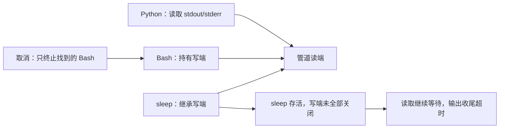

# 子进程取消与管道收尾：上游实现对比

核查日期：2026-10-21。范围是 Windows Python 3.12 调用 Git Bash，以及 POSIX 对照。只采用官方仓库源码和 Python / Microsoft 文档。源码事实、本机实验和工程判断分别记录；上游 issue 中的建议不作为已实现行为。

## 结论与适用范围

这些实现展示了两个可分别采用的方向：启动时建立可管理的进程归属，以及限制取消后的输出收尾等待。它们并非都在每个平台同时做到两项；例如 mini-swe-agent 的 Windows 分支只终止直接进程。POSIX 的 `killpg`、Windows 控制台进程组与 Job Object 也不能互换。

| 项目与核查版本 | POSIX 路径 | Windows 路径 | 对当前 Git Bash 故障的含义 |
|---|---|---|---|
| mini-swe-agent，固定提交 `04d809ceab9df28f9adaed044884180159172930` | `start_new_session=True`，超时后 `killpg(SIGKILL)` | 超时后只 `process.kill()` | 很短，但 Windows 没有整棵树清理保证，不能直接当修复 |
| OpenCode，固定提交 `95daf90670b7c039c436c85537da5fbfe2205b41` 的 `killTree` | 对负 PID 发 SIGTERM，200ms 后 SIGKILL，失败退到单进程 | `taskkill /pid PID /f /t` | 可复用的短方案，但本机实验仍漏掉 sleep |
| OpenCode，核查时 `dev` 的 `cross-spawn-spawner.ts` | `killGroup` 对负 PID 发信号 | 仍调用 `taskkill /pid PID /T /F`；此外 root 退出后只等输出关闭 1 秒 | 区分“进程退出”和“管道关闭”，防止继承管道让调用永久等待 |
| Codex，核查时 `main` 的 `utils/pty/src/pipe.rs` | 新 session，按进程组 interrupt / kill | 尝试分配到 Job Object，终止整个 Job；分配失败回退单 PID | Job Object 是不依赖枚举后代的方向，但 Python 接入比两行控制台信号复杂 |

来源：[mini-swe-agent 固定源码](https://github.com/SWE-agent/mini-swe-agent/blob/04d809ceab9df28f9adaed044884180159172930/src/minisweagent/environments/local.py#L66-L86)、[OpenCode 固定源码](https://github.com/anomalyco/opencode/blob/95daf90670b7c039c436c85537da5fbfe2205b41/packages/core/src/shell.ts#L28-L56)、[OpenCode 当前进程适配器](https://github.com/anomalyco/opencode/blob/dev/packages/util/src/cross-spawn-spawner.ts)、[Codex pipe 实现](https://github.com/openai/codex/blob/main/codex-rs/utils/pty/src/pipe.rs)。

版本限制：搜索索引中的 OpenCode `packages/core/src/shell.ts` 仍显示旧 `killTree`，但直接读取 `dev` 已是新的 Effect 服务，取消实现搬到 `packages/util/src/cross-spawn-spawner.ts`。上表明确保留固定历史版本和浮动分支版本的区别。GitHub API 在当前环境无法取得最新 SHA，故没有把浮动分支伪标成某个 commit 或发布版本；重新引用时应重新核查。

## 为什么杀掉 Bash 之后，读取仍然等不到 EOF



Windows 匿名管道只有全部写句柄关闭后，读取方才会看到结束；因此“根进程结束”与“输出读取结束”不是同一件事。Microsoft 官方示例专门要求关闭不再使用的继承句柄，避免无法判断子进程操作完成。[Windows 管道与句柄继承](https://learn.microsoft.com/en-us/windows/win32/procthread/creating-a-child-process-with-redirected-input-and-output)

OpenCode 当前适配器也直接处理这个边界：根进程 `exit` 后等待 `close` 至多 1 秒，之后停止输出捕获并处理残余流。该做法限制等待时间，本身并不证明所有后代已被终止。[上游实际实现](https://github.com/anomalyco/opencode/blob/dev/packages/util/src/cross-spawn-spawner.ts)

## 两个 Windows 原生方向

### 同一控制台：进程组与 CTRL_BREAK

Python 标准库支持创建进程时指定 `CREATE_NEW_PROCESS_GROUP`，之后向组发送 `CTRL_BREAK_EVENT`。Windows 用组根 PID 作为组 ID，可让同一控制台中的组成员收到事件；组内创建新控制台的进程不会收到。必须使用非零目标组 ID，不能广播给整个父控制台。[Python subprocess 文档](https://docs.python.org/3.12/library/subprocess.html#subprocess.Popen.send_signal)、[Microsoft GenerateConsoleCtrlEvent](https://learn.microsoft.com/en-us/windows/console/generateconsolectrlevent)

```python
# 仅展示系统接口，尚需接入现有等待、超时与清理失败处理。
creationflags=subprocess.CREATE_NEW_PROCESS_GROUP
os.kill(process.pid, signal.CTRL_BREAK_EVENT)
```

这是 Windows 控制台机制，不是 mini-swe-agent 的 POSIX `killpg`，也不是 Codex pipe 的当前 Windows 实现。事件可以被 handler 处理，不能当成不可逃逸的强制隔离；无控制台、创建新控制台等环境需要其他处理。

### 无需共同控制台：Job Object

Windows Job Object 可以让进程作为一组管理，默认让随后创建的子进程继承成员身份，`TerminateJobObject` 终止成员。[Microsoft Job Objects](https://learn.microsoft.com/en-us/windows/win32/procthread/job-objects)

Codex 的 pipe 实现先 spawn，再 assign 到 Job，源码明确承认这段间隙内产生的后代可能逃逸。`Interrupt` 在 Windows 走相同 kill 入口；失败回退只终止根 PID，不能把回退称作整树保证。[Codex pipe](https://github.com/openai/codex/blob/main/codex-rs/utils/pty/src/pipe.rs)

Codex 的 Job 封装还提供挂起创建、分配再恢复的入口，并设置 `KILL_ON_JOB_CLOSE`；默认 `create()` 另允许显式 breakaway，不能宣称任意后代绝对无法脱离。挂起启动与普通 pipe 的先 spawn 再 assign 是不同路径。[Codex Job 封装](https://github.com/openai/codex/blob/main/codex-rs/utils/pty/src/win/job.rs)

## 本机实验，与上游事实分开

以下是本次排错主任务报告的独立实验结果，不能据此扩展成所有 Windows 环境保证：

| 候选方式 | 当前观察 |
|---|---|
| 原有 psutil 原生后代快照 | 找到两个 Bash，漏掉 MSYS sleep；输出收尾超时 |
| OpenCode 风格 `taskkill /PID root /F /T` | 返回 0，仍漏掉 sleep，继续出现输出收尾超时 |
| MSYS 进程表补充 Windows PID 后再清理 | 原命令可取消，相关 Bash 与 sleep 退出；需要专用进程表解析 |
| 创建新控制台进程组，然后定向 CTRL_BREAK | 补充等待后，本次关联 Bash 与 sleep 全部退出；真实 TTY Ctrl+C 后返回提示符，下一次 Bash 调用成功，管道均 EOF |

本项目现采用同一控制台中的进程组方案，保留原生快照兜底和独立输出收尾上限。
真实取消、超时及后续运行已验证，详见 [修复记录](../design/m4b-git-bash-cancellation.md)。
这不能扩大为无控制台或所有后代不可逃逸的保证。Job Object 是跨控制台场景可研究的系统方案，
当前未在该项目中实测，不将它自动升级为本阶段前置条件。
